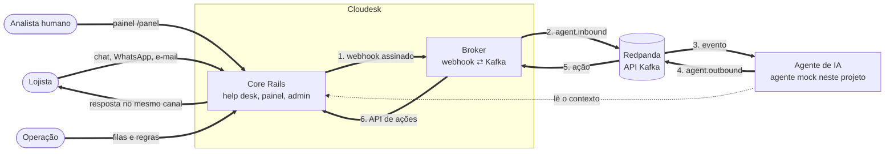
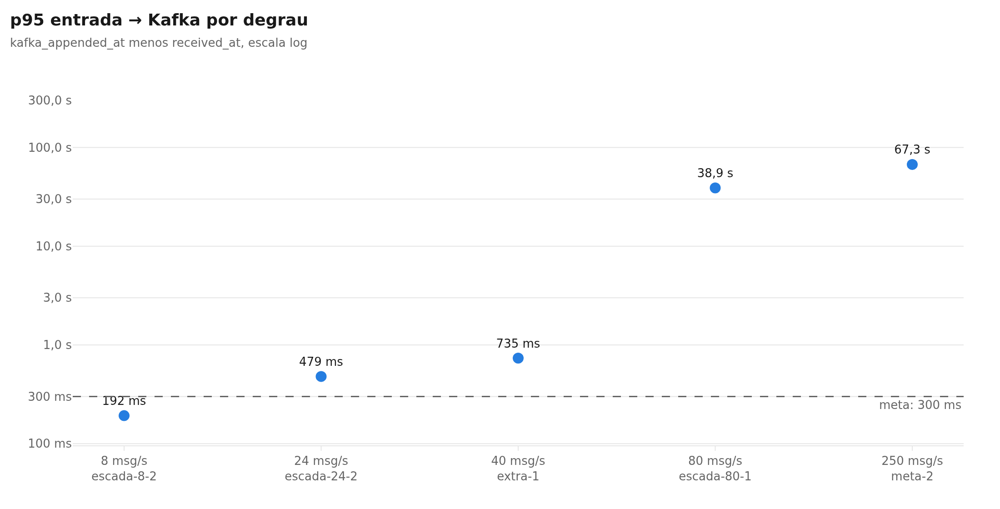
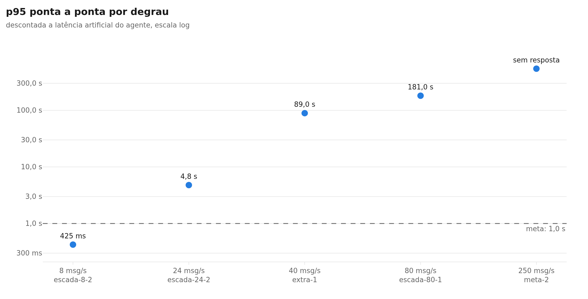
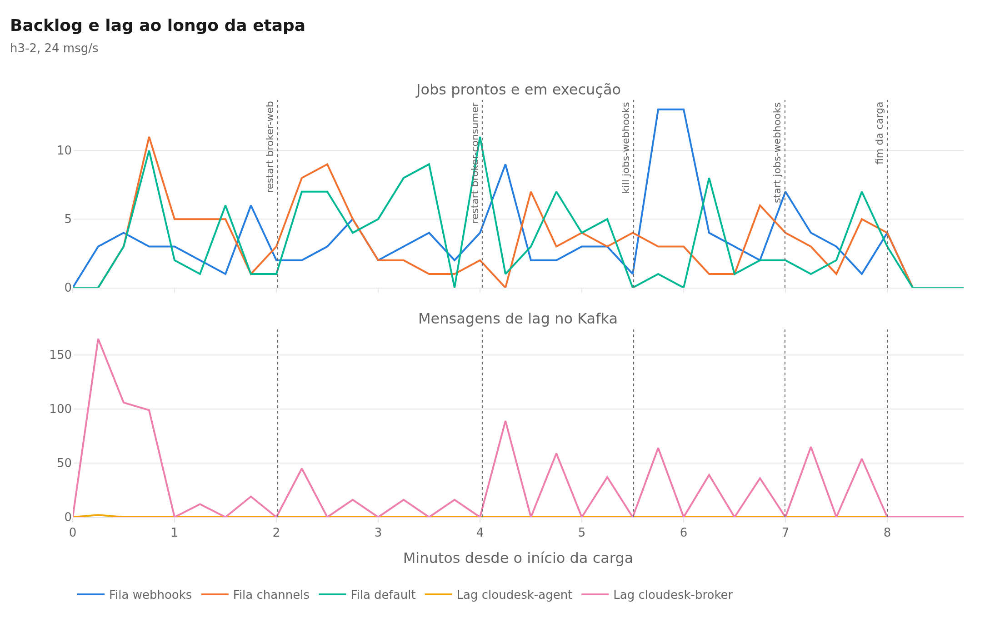

# Cloudesk

O Cloudesk é uma plataforma de help desk própria, AI-first, multi-marca e multi-equipe, self-hosted, construída para a CloudWalk. O lojista escreve por chat, WhatsApp ou e-mail; a plataforma classifica e roteia a conversa; um agente de IA atende como um usuário da plataforma, integrado por webhooks, broker e Kafka; e o analista humano assume por escalação, com resumo e contexto. Os canais e o agente são simulados, e todos os dados são sintéticos.

## Índice

1. [Problema e recorte da solução](#problema-e-recorte-da-solução)
2. [Arquitetura](#arquitetura)
3. [Instalação e execução](#instalação-e-execução)
4. [Modelos e configurações](#modelos-e-configurações)
5. [Metodologia experimental](#metodologia-experimental)
6. [Resultados](#resultados)
7. [Limitações](#limitações)
8. [Possibilidades de evolução](#possibilidades-de-evolução)

## Problema e recorte da solução

A CloudWalk opera várias marcas, entre elas a InfinitePay no Brasil e a JIM nos Estados Unidos, e atende microempreendedores em alto volume por chat, WhatsApp e e-mail. O help desk atual é de terceiros: é lento, tem problemas recorrentes e não prioriza o que a operação pede. Uma fila única não basta: a operação precisa de filas por marca, equipe, categoria e prioridade, editáveis por ela mesma, sem desenvolvimento.

**Pergunta norteadora:** como construir uma plataforma própria, AI-first, multi-equipe e multi-marca, que integre agentes de IA como atendentes de ponta a ponta, distribua os casos em filas configuráveis e escale para o volume da operação, com priorização e handoff humano?

| Perfil | O que faz |
| - | - |
| Lojista | Abre solicitações por chat, WhatsApp ou e-mail |
| Agente de IA | Recebe conversas, lê o contexto, consulta ferramentas e responde, escala, recategoriza ou resolve |
| Analista humano | Recebe as escalas no painel, com resumo, contexto e histórico, e resolve os casos complexos |

**No escopo:** a plataforma completa, o broker, um agente mock determinístico, um simulador dos três canais, observabilidade e um experimento de carga e falhas.

**Fora do escopo:** o agente de IA real, dados reais de clientes, integração com sistemas de produção e apps móveis.

**LGPD:** lojistas, transações e conversas são gerados por seeds fixas com Faker. Nenhum dado pessoal real é usado.

### Requisitos do enunciado (TAPI)

| Requisito | Onde é atendido |
| - | - |
| Recebimento por chat, WhatsApp e e-mail simulados | Entradas no formato da Cloud API, chat JSON e widget, e-mail pelo Mailpit: [canais](documents/fases/05-canais-de-entrada-e-identidade.md) e [simulador](documents/fases/06-simulador-de-canais.md) |
| Filas múltiplas, configuráveis e editáveis pela operação | Filas e regras são dados, editados em `/admin`, versionados e auditados: [admin](documents/fases/14-admin-de-filas-e-regras.md) |
| Interface de conversa entre cliente e atendente | Widget de chat em tempo real, em `/chat/infinitepay` e `/chat/jim` |
| Painel do analista com fila de escalas, contexto e histórico | `/panel`: [handoff e painel](documents/fases/12-handoff-painel-e-timeout.md) |
| Integração por webhooks e broker | Webhook assinado, Broker, Kafka e o caminho inverso: [contrato](documents/fases/04-contrato-de-integracao.md) e [Broker](documents/fases/10-broker.md) |
| Triagem, priorização e distribuição | Classificador, regras e atribuição por capacidade: [roteamento](documents/fases/07-triagem-roteamento-e-distribuicao.md) |
| Handoff com resumo e contexto | Ação `escalate`, com o histórico na mesma conversa: [handoff](documents/fases/12-handoff-painel-e-timeout.md) |
| Rastreabilidade e auditoria | `audit_events` append-only e linha do tempo por mensagem: [auditoria](documents/fases/03-nucleo-transacional-e-auditoria.md) e [linha do tempo](documents/fases/15-observabilidade.md) |
| Memória e contexto entre interações | Histórico da conversa, memória do lojista e identidade entre canais: [memória](documents/fases/13-memoria-e-contexto.md) |

### Diferenciais

1. **Briefing de handoff avaliado pelo analista:** o cartão do handoff traz o que a IA tentou, as ferramentas, o próximo passo e a confiança, e o analista o marca como útil ou não.
2. **Cockpit operacional em tempo real:** dashboard do Grafana com filas, risco de SLA, contenção da IA, motivos de escalação, lag, backlog e alertas.
3. **"Por que caiu aqui?":** a tela da conversa mostra a regra e a versão que definiram fila, prioridade e SLA.
4. **Modos de falha do agente mock:** atraso, sem resposta, ação duplicada e ação desatualizada, por configuração ou por marcador no texto.

## Arquitetura

Um monólito modular em Rails integrado a um broker Kafka, espelhando a estrutura de referência: help desk, webhooks, broker, tópico Kafka, agente de IA e o caminho inverso.



**Caminho de uma mensagem:**

1. O canal chama a entrada do Core, que normaliza a mensagem.
2. A triagem define categoria e urgência; a primeira regra que casa define fila, prioridade, SLA e atendente inicial.
3. Em uma transação, o Core grava mensagem, roteamento, `audit_events` e, com a conversa na IA, o job de webhook.
4. O `jobs-webhooks` envia o webhook assinado ao Broker, que publica em `agent.inbound` e responde 2xx só depois da confirmação do Kafka.
5. O agente lê o contexto da conversa, consulta as ferramentas e publica uma ação em `agent.outbound`.
6. O Broker envia a ação à API do Core, com `Idempotency-Key` e assinatura HMAC.
7. O Core confere estado e sequência, aplica a ação e entrega a resposta no canal da mensagem.
8. Em `escalate`, ou sem resposta da IA dentro do SLA, a conversa vai à fila humana com o handoff.

### Princípios

| Princípio | Na prática |
| - | - |
| Um único sistema de estado | Domínio, fila de jobs, tempo real e cache no PostgreSQL; não existe Redis nem dual-write |
| Atomicidade na origem | Mensagem, auditoria e job de saída na mesma transação |
| Toda decisão é auditada | Cada decisão gera um `audit_event` com payload completo, regra e versão |
| Escala por papel | Uma imagem e um código, com processos separados por papel |
| Infraestrutura proporcional ao problema | Cada componente atende a um requisito ou a uma hipótese do experimento |

### Componentes e escolhas

| Componente | Tecnologia | Por que |
| - | - | - |
| Core | Rails 8.1 com Hotwire | Ruby é referência no TAPI; um app só cobre API, chat, painel e admin, e os módulos separam os contextos de negócio |
| Banco | PostgreSQL 18 | Transação única para domínio, auditoria e jobs; Row-Level Security isola as marcas; `uuidv7()` nativo |
| Jobs, tempo real e cache | Solid Queue, Solid Cable, Solid Cache | Ficam no mesmo banco: o job nasce na transação do dado (outbox implícito), sem outro sistema de estado |
| Broker | Karafka e endpoint Rack | Compartilha o contrato e a assinatura com o Core, mas roda sem Rails e sem banco, com fronteira HTTP |
| Mensageria | Redpanda | API Kafka, a da estrutura de referência, em um único nó local |
| Agente mock | Python com aiokafka | Serviço separado, em outra linguagem: prova que o contrato não depende do Core. A decisão é determinística |
| Simulador de canais | Python com aiohttp | Faz o papel dos provedores de canal: envia, recebe e registra cada resposta para a reconciliação |
| E-mail | Action Mailbox e Mailpit | Canal de e-mail completo, sem serviço externo |
| Balanceador | nginx | Distribui HTTP e WebSocket entre as réplicas do `web` |
| Observabilidade | Prometheus e Grafana | Métricas das hipóteses, cockpit e alertas, sem instrumentar os caminhos quentes do Core |
| Experimento | k6, pandas e Plotly | Carga com taxa de chegada constante e análise reproduzível |
| Empacotamento | Docker Compose | Self-hosted: a máquina precisa só de Docker e Git |
| Testes | RSpec e pytest | Os testes de contrato em Ruby e Python validam os mesmos exemplos |

### Garantias

- **Atomicidade:** a mensagem, o `audit_event` e o job de saída existem juntos ou não existem.
- **At-least-once com idempotência:** a mesma ação processada duas vezes tem efeito uma vez só no Core (`processed_events`).
- **Ação desatualizada:** a ação que ignora mensagem mais nova do lojista recebe `409 stale`; a ação com a conversa fora da IA recebe `409 rejected`. As duas são auditadas.
- **Isolamento:** toda tabela de domínio tem `brand_id` e Row-Level Security forçado; a aplicação usa um papel sem privilégio de dono.
- **Auditoria append-only:** `UPDATE`, `DELETE` e `TRUNCATE` em `audit_events` são bloqueados por permissão e trigger.

### Pastas

| Pasta | Conteúdo |
| - | - |
| [core/](core/README.md) | App Rails: Core e código do Broker |
| `contracts/` | Schemas, exemplos e vetores do contrato entre Core, Broker e agente |
| `agent_mock/` | Agente mock |
| `agent_conformance/` | Kit de conformidade do agente |
| `channel_simulator/` | Simulador de canais |
| [experiment/](experiment/README.md) | Roteiro, carga, análise e resultados do experimento |
| `infra/` | Postgres, Redpanda, nginx, Prometheus e Grafana |
| `documents/` | Arquitetura, documentos por parte e manual de marca |

### Documentos

A [arquitetura completa](documents/arquitetura.md) traz os diagramas, as decisões de design e os custos de cada uma. Cada parte tem um documento próprio:

[01 Repositório e infraestrutura](documents/fases/01-repositorio-e-infraestrutura-local.md) ·
[02 Banco e entidades](documents/fases/02-banco-multi-marca-e-entidades.md) ·
[03 Núcleo transacional e auditoria](documents/fases/03-nucleo-transacional-e-auditoria.md) ·
[04 Contrato](documents/fases/04-contrato-de-integracao.md) ·
[05 Canais](documents/fases/05-canais-de-entrada-e-identidade.md) ·
[06 Simulador](documents/fases/06-simulador-de-canais.md) ·
[07 Roteamento](documents/fases/07-triagem-roteamento-e-distribuicao.md) ·
[08 Saída para o Broker](documents/fases/08-saida-core-broker.md) ·
[09 API de ações e contexto](documents/fases/09-api-de-acoes-e-contexto.md) ·
[10 Broker](documents/fases/10-broker.md) ·
[11 Agente mock](documents/fases/11-agente-mock.md) ·
[12 Handoff, painel e timeout](documents/fases/12-handoff-painel-e-timeout.md) ·
[13 Memória](documents/fases/13-memoria-e-contexto.md) ·
[14 Admin](documents/fases/14-admin-de-filas-e-regras.md) ·
[15 Observabilidade](documents/fases/15-observabilidade.md) ·
[16 Robustez e escala](documents/fases/16-robustez-e-escala.md) ·
[17 Melhorias do agente mock](documents/fases/17-avaliacao-de-melhorias-do-agente-mock.md) ·
[18 Experimento](documents/fases/18-experimento-tecnico.md) ·
[Manual de marca](documents/manual-de-marca.md)

## Instalação e execução

### Pré-requisitos

- Git e Docker com Compose v2. Nada mais é instalado na máquina.
- Portas 3000, 3002, 8080, 8025, 1025, 9090 e 19092 livres.
- Versões testadas: Docker 29.8.2 e Docker Compose v5.6.0, no Windows com WSL2. Com todos os serviços de pé e sem carga, os contêineres usam cerca de 2,5 GiB de memória, em um Docker com 7,6 GiB.

### Primeira subida

Os comandos são os mesmos no Bash e no PowerShell.

```text
git clone https://github.com/lcordeirokopke/Cloudesk.git
cd Cloudesk
cp .env.example .env
docker compose build
docker compose run --rm web sh -c 'DB_USERNAME=$DB_OWNER_USERNAME DB_PASSWORD=$DB_OWNER_PASSWORD bin/rails db:migrate db:seed'
docker compose up -d
docker compose exec web bin/rails simulator:personas
```

- A migração vem antes da subida porque os workers precisam das tabelas. O `run` sobe o Postgres e espera a saúde dele.
- O `.env.example` traz senhas e segredos de demonstração, que qualquer leitor do repositório conhece. Eles servem só para uso local com dados sintéticos; fora disso, troque todos.
- As senhas do Postgres (`POSTGRES_SUPERUSER_PASSWORD`, `DB_OWNER_PASSWORD` e `DB_APP_PASSWORD`) e a do administrador do Grafana valem na criação dos volumes. Trocá-las depois exige volume novo (ver [Parar e recomeçar](#parar-e-recomeçar)).

### Conferência

`docker compose ps -a` mostra `redpanda-init` e `postgres-monitor-init` terminados com código 0 e os demais serviços de pé. `http://localhost:3000/up` responde 200.

A primeira mensagem de ponta a ponta confere a instalação:

```text
docker compose exec channel-simulator channel-simulator scenario reply --brand infinitepay
```

O comando envia uma pergunta por WhatsApp, confere a resposta que volta ao canal e imprime um `docker compose exec web bin/rails demo:check ...`. Execute a linha impressa: ela confere o estado no Core e termina com código 0.

### Endereços e credenciais

| Endereço | O que é | Credencial no `.env` |
| - | - | - |
| `http://localhost:3000/chat/infinitepay` e `/chat/jim` | Widget de chat | Escolha do lojista na tela |
| `http://localhost:3000/panel` | Painel do analista | `PANEL_USER`, `PANEL_PASSWORD` |
| `http://localhost:3000/admin` e `/admin/dlq` | Filas, equipes, atendentes, regras e DLQ | `ADMIN_USER`, `ADMIN_PASSWORD` |
| `http://localhost:3000/jobs` | Jobs e fila de falhas do Solid Queue | `MISSION_CONTROL_USER`, `MISSION_CONTROL_PASSWORD` |
| `http://localhost:3002` | Grafana, com o cockpit na página inicial | Leitura anônima; `GRAFANA_ADMIN_USER`, `GRAFANA_ADMIN_PASSWORD` para administrar |
| `http://localhost:9090` | Prometheus | Sem senha |
| `http://localhost:8025` | Mailpit | Sem senha |

Os logins de lojista, analista e operador são simulados: depois do basic auth, a pessoa escolhe a marca e, no painel, o analista.

### Cenários do simulador

`docker compose exec channel-simulator channel-simulator scenario <nome> --brand <infinitepay|jim>`

| Cenário | O que exercita |
| - | - |
| `reply` | Pergunta de taxas por WhatsApp, respondida pela IA |
| `handoff` | Mensagem sem intenção, escalada ao analista com briefing |
| `reopen` | Conversa resolvida e reaberta pelo lojista no prazo |
| `memory` | Conversa seguinte com a memória do lojista, em duas partes |
| `cross-channel` | Um lojista das seeds escreve por WhatsApp, chat e e-mail na mesma conversa |
| `failure-duplicate` | Ação publicada duas vezes, com efeito uma vez só |
| `failure-stale` | Ação desatualizada, recusada com `409 stale`, e escalação por timeout |
| `failure-drop` | Agente sem resposta: mensagem de espera e escalação por timeout |
| `failure-delay` | Agente atrasado: mensagem de espera e resposta antes do SLA |

Os cenários `failure-stale`, `failure-drop` e `failure-delay` pedem o SLA de demonstração de 1 minuto: `docker compose exec web bin/rails panel:demo_sla BRAND=infinitepay MINUTES=1` antes e `docker compose exec web bin/rails panel:demo_sla_reset BRAND=infinitepay` depois. Os detalhes estão em [simulador de canais](documents/fases/06-simulador-de-canais.md).

### Escala

Cada papel escala por réplica, por exemplo `docker compose up -d --scale web=2 --scale jobs-webhooks=2 --scale broker-web=2 --scale broker-consumer=2 --scale agent-mock=2`. `web-lb` e `metrics` ficam com uma réplica. O dimensionamento está em [robustez e escala](documents/fases/16-robustez-e-escala.md).

### Testes

Com o ambiente de pé:

```text
docker compose exec web sh -c 'RAILS_ENV=test DB_USERNAME=$DB_OWNER_USERNAME DB_PASSWORD=$DB_OWNER_PASSWORD bin/rails db:migrate'
docker compose exec -e RAILS_ENV=test web bundle exec rspec
docker compose run --rm agent-mock pytest
docker compose exec channel-simulator pytest
docker compose --profile conformance up --build --abort-on-container-exit --exit-code-from agent-conformance agent-conformance agent-mock-conformance
```

O último comando roda o kit de conformidade do agente; o código de saída é o do pytest do kit. Ao terminar, só os dois contêineres do kit param; os demais serviços seguem de pé.

### Experimento

Os comandos estão em [experiment/README.md](experiment/README.md). O projeto `cloudesk` precisa estar parado (`docker compose stop`) durante o experimento, que usa o projeto `cloudesk-experiment`, com rede e volumes próprios.

### Parar e recomeçar

- `docker compose stop` para tudo e mantém os dados; `docker compose up -d` retoma.
- `docker compose down -v` **apaga todos os dados locais** dos volumes. Para recomeçar, repita a primeira subida a partir da migração.

## Modelos e configurações

### Agente mock

O agente é um mock determinístico, sem LLM. A mesma mensagem, com o mesmo contexto, gera sempre a mesma ação.

| Item | Valor |
| - | - |
| Nome e versão | `agent-mock` `0.1.0`, gravados em `model` de cada ação |
| Decisão | Intenção por palavras-chave no locale da marca (`infinitepay` pt-BR, `jim` en-US) |
| Ferramentas falsas | `consultar_transacao`, `consultar_repasse`, `consultar_taxas` e `status_maquininha`, com retorno derivado do SHA-256 da entrada |
| Latência artificial | `AGENT_LATENCY_MS`, fixa, informada na ação e descontada da medida ponta a ponta |
| Concorrência | `AGENT_CONCURRENCY` eventos por processo, em série dentro da conversa |
| Memória | Prefixo na resposta e ajuste da confiança com conversa do mesmo assunto nos últimos `AGENT_MEMORY_WINDOW_DAYS` dias |
| Modos de falha | `AGENT_FAILURE_MODE` (`none`, `delay`, `drop`, `duplicate`, `stale`), `AGENT_FAILURE_RATE` e `AGENT_FAILURE_DELAY_MS`, ou o marcador `[falha:<modo>]` no texto |

O [kit de conformidade](documents/fases/17-avaliacao-de-melhorias-do-agente-mock.md) confere o contrato em qualquer agente, sem exigir determinismo. O detalhamento está em [agente mock](documents/fases/11-agente-mock.md).

### Classificador de entrada

Palavras-chave por marca e categoria em `core/config/routing/classifier.yml`, com versão por marca (versão 2 nas duas). Cada categoria tem `terms` (peso 2) e `context` (peso 1); vence a maior pontuação. A urgência `high` vem de uma lista própria. O detalhamento está em [roteamento](documents/fases/07-triagem-roteamento-e-distribuicao.md).

### Variáveis do `.env`

| Grupo | Variáveis | Valor no `.env.example` |
| - | - | - |
| Postgres, superusuário | `POSTGRES_SUPERUSER`, `POSTGRES_SUPERUSER_PASSWORD` | `postgres`, demonstração |
| Postgres, dono das tabelas | `DB_OWNER_USERNAME`, `DB_OWNER_PASSWORD` | `cloudesk_owner`, demonstração |
| Postgres, aplicação | `DB_APP_USERNAME`, `DB_APP_PASSWORD` | `cloudesk_app`, demonstração |
| Postgres, monitoração | `DB_MONITOR_USERNAME`, `DB_MONITOR_PASSWORD` | `cloudesk_monitor`, demonstração |
| Bancos | `DB_DEVELOPMENT_NAME`, `DB_TEST_NAME` | `cloudesk_development`, `cloudesk_test` |
| WhatsApp | `WHATSAPP_APP_SECRET`, `WHATSAPP_VERIFY_TOKEN`, `WHATSAPP_ACCESS_TOKEN`, `WHATSAPP_API_URL` | Demonstração; `http://channel-simulator:8080/v1` |
| Chat | `CHAT_SIGNING_SECRET` | Demonstração |
| Mailpit | `MAILPIT_WEBHOOK_USER`, `MAILPIT_WEBHOOK_PASSWORD` (só letras e números) | `mailpit`, demonstração |
| Webhook ao Broker | `BROKER_WEBHOOK_URL`, `BROKER_WEBHOOK_SECRET` | `http://broker-web:3000/webhooks/message-created`, demonstração |
| DLQ | `BROKER_DLQ_SECRET` | Demonstração |
| API do agente | `AGENT_ACTIONS_SECRET`, `AGENT_CONTEXT_SECRET` | Demonstração |
| Telas | `MISSION_CONTROL_*`, `PANEL_*`, `ADMIN_*` (`_USER` e `_PASSWORD`) | `admin`, `analyst` e `operator`, demonstração |
| Grafana | `GRAFANA_ADMIN_USER`, `GRAFANA_ADMIN_PASSWORD` | `admin`, demonstração |

Opcionais, comentadas no arquivo, com o padrão do Compose:

| Variável | Padrão | Uso |
| - | - | - |
| `KAFKA_BROKERS` | `redpanda:9092` | Endereços do Kafka |
| `CORE_ACTIONS_URL` | `http://web-lb:3000/api/v1/agent/actions` | API de ações chamada pelo Broker |
| `BROKER_DLQ_URL` | `http://broker-web:3000` | Endpoints da DLQ chamados pelo Core |
| `CLOUDESK_LOAD_PROFILE` | vazio | `1` liga o perfil de carga: sem recarregamento, código carregado no boot e menos logs |
| `WEB_MAX_THREADS` | `3` | Threads do Puma e conexões do pool de cada réplica do `web` |
| `POSTGRES_MAX_CONNECTIONS` | `200` | `max_connections` do Postgres |
| `AGENT_LATENCY_MS` | `0` | Latência artificial |
| `AGENT_CONCURRENCY` | `100` | Eventos em andamento por processo |
| `AGENT_FAILURE_MODE`, `AGENT_FAILURE_RATE`, `AGENT_FAILURE_DELAY_MS` | `none`, `1`, `0` | Modo de falha |
| `AGENT_MEMORY_WINDOW_DAYS` | `30` | Janela da memória |
| `AGENT_INBOUND_TOPIC`, `AGENT_OUTBOUND_TOPIC` | `agent.inbound`, `agent.outbound` | Tópicos do agente; o Compose não os passa ao `agent-mock` |

### Dados sintéticos

As seeds usam a semente `20_261_115` e o Faker nos locales pt-BR (InfinitePay) e en-US (JIM): por marca, 50 lojistas, 4 analistas humanos, 1 atendente IA, equipes, filas, regras e canais. Rodar as seeds de novo não duplica registros.

### Versões

| Tecnologia | Versão |
| - | - |
| Ruby on Rails | 8.1.4.1 |
| Solid Queue, Solid Cable, Solid Cache | 1.7.2, 4.1.0, 1.0.10 |
| Karafka, WaterDrop | 2.6.1, 2.10.10 |
| Puma, Turbo Rails, Mission Control - Jobs | 8.1.1, 2.0.23, 1.3.1 |
| prometheus-client, RSpec Rails, Faker | 5.0.0, 8.1.0, 3.8.0 |
| aiokafka, aiohttp (agente mock e kit) | 0.15.0, 3.14.5 |
| Redpanda | v26.2.7 |
| nginx | 1.30.8 |
| Prometheus, Grafana, postgres_exporter | v3.16.0, 13.3.1, v0.21.1 |
| k6, pandas, Plotly, numpy, scipy, kaleido | 2.4.0, 3.1.1, 7.1.0, 2.5.5, 1.18.1, 1.5.2 |

Sem versão exata: a imagem `axllent/mailpit` não tem tag; `postgres:18`, `ruby:3.4-slim` e `python:3.13-slim` não fixam a versão menor; e o simulador de canais não fixa `aiohttp`, `pytest` e `pytest-aiohttp`. A versão em uso depende de quando a imagem é baixada ou construída.

## Metodologia experimental

**Pergunta:** a plataforma sustenta o volume de referência, com as latências alvo, e não perde nem duplica mensagens com falhas de processo? Cada hipótese é avaliada separadamente, para que o resultado de uma não esconda o de outra.

| # | Hipótese | Critério |
| - | - | - |
| H1 | 250 msg/s por 15 min sem acúmulo crescente de backlog | (a) Limite superior do IC 95% da inclinação do backlog abaixo de 1% da taxa; (b) pelo menos 99% da taxa aceita; (c) backlog zerado em até 60 s |
| H2 | Nessa carga, entrada → Kafka com p95 < 300 ms | Pelo menos 95% das mensagens até 0,3 s |
| H3 | Com o Broker reiniciado e um worker morto, nada é perdido nem duplicado | 0 perdidas, 0 duplicadas e `robustness:check` com código 0 |
| H4 | Nessa carga, ponta a ponta com p95 < 1 s | p95 exato, descontada a latência artificial do agente |
| H5 | A 8 msg/s por 3 min, a plataforma sustenta a carga | O mesmo da H1 |
| H6 | Nessa carga, entrada → Kafka com p95 < 300 ms | O mesmo da H2 |
| H7 | Nessa carga, ponta a ponta com p95 < 1 s | O mesmo da H4 |

H1 a H4 são as hipóteses originais, com alvo de 250 msg/s. **H5 a H7 são informadas pelos pilotos:** são definidas depois deles e antes da primeira execução a 8 msg/s, a média em horário comercial do volume de referência.

### Métodos e justificativa

| Método | Por que |
| - | - |
| k6 com taxa de chegada constante, sem reenvio | A carga não diminui quando o sistema fica lento, como no tráfego real; a taxa não alcançada aparece como iteração descartada |
| Critérios numéricos fixados antes da medida | O veredito não depende de interpretação do resultado |
| `audit_events` para o valor exato das latências | Os carimbos de cada salto são gravados pelo próprio sistema, sem a aproximação dos buckets do histograma |
| Reconciliação por mensagem | Cada envio tem identificador único, comparado com o Core e com as respostas recebidas no canal: perda e duplicação são contadas, não estimadas |
| Toda execução listada | As que não contam como medida também aparecem, com o motivo |

### Etapas

| Etapa | Carga |
| - | - |
| Ensaio | 5 msg/s por 1 min |
| Piloto | Rodadas de 3 min, que escolhem as réplicas e a taxa da H3 |
| H3 | 24 msg/s por 8 min, com as falhas |
| Escada | 8 e 24 msg/s por 3 min e 80 por 5 min |
| Meta | 250 msg/s por até 15 min; para no minuto 5 com a H1 já reprovada |
| Extra | 40 msg/s por 5 min |
| E-mail | 10 e-mails, 1 por segundo, fora da carga |

**Falhas da H3:** no minuto 2, `docker restart` de todas as réplicas do `broker-web`; no minuto 4, de todas as do `broker-consumer`; no minuto 5,5, `docker kill` de uma réplica do `jobs-webhooks`, religada no minuto 7.

**Carga:** 90% WhatsApp e 10% chat, conversas de 5 mensagens do lojista a cada 20 s, sem escalação, `AGENT_LATENCY_MS=200`.

**Condições:** um notebook com Windows e WSL2, 12 CPUs lógicas e 7,6 GiB visíveis ao Docker 29.8.2, com o gerador de carga na mesma máquina; réplicas `web=6`, `jobs-webhooks=2`, `jobs-default=2`, `broker-web=2`, `broker-consumer=2` e `agent-mock=1` (`web=4` no ensaio e nos pilotos 1 e 2); `RAILS_ENV=development` com o perfil de carga e YJIT desligado.

O método completo está em [experimento técnico](documents/fases/18-experimento-tecnico.md), e os comandos, em [experiment/README.md](experiment/README.md).

## Resultados

Na máquina do experimento, a plataforma não sustenta 250 msg/s; a 24 msg/s com falhas de processo, não há perda nem duplicação; a 8 msg/s, as metas de latência valem.

### Hipóteses (sessão `20261125T004706Z`)

| # | Veredito | Execução | Números |
| - | - | - | - |
| H1 | Refutada | `meta-2` | 17,0% da taxa aceita; backlog de até 15.218, que não zera; limite superior da inclinação de 61,4/s contra 2,5/s |
| H2 | Refutada | `meta-2` | 0,9% das mensagens até 0,3 s; p95 de 67,3 s |
| H3 | Confirmada a 24 msg/s | `h3-2` | 11.515 enviadas e atendidas; 0 perdidas e 0 duplicadas |
| H4 | Refutada | `meta-2` | p95 infinito: há mensagens sem resposta na coleta |
| H5 (informada pelos pilotos) | Refutada pelo intervalo | `escada-8-2` | Inclinação de -0,0044/s, com limite superior de 0,16/s contra 0,08/s |
| H6 (informada pelos pilotos) | Confirmada | `escada-8-2` | 99,5% até 0,3 s; p95 de 192 ms |
| H7 (informada pelos pilotos) | Confirmada | `escada-8-2` | p95 de 0,425 s |

### Por degrau

| Execução | Taxa pedida | Taxa aceita | p95 entrada → Kafka | p95 ponta a ponta | Perdidas | Duplicadas |
| - | - | - | - | - | - | - |
| `escada-8-2` | 8 msg/s | 100% | 0,192 s | 0,425 s | 0 | 0 |
| `escada-24-2` | 24 msg/s | 99,9% | 0,479 s | 4,8 s | 0 | 0 |
| `extra-1` | 40 msg/s | 99,3% | 0,735 s | 89,0 s | 0 | 0 |
| `escada-80-1` | 80 msg/s | 67,4% | 38,9 s | 181,0 s | 0 | 0 |
| `meta-2` | 250 msg/s | 17,0% | 67,3 s | infinito | 3.612 (ver abaixo) | 0 |



*p95 entrada → Kafka nos degraus de 8, 24, 40, 80 e 250 msg/s. Só o de 8 msg/s fica abaixo da meta.*



*p95 ponta a ponta, descontada a latência artificial, nos degraus de 8, 24, 40, 80 e 250 msg/s. Só o de 8 msg/s fica abaixo da meta.*



*Backlog e lag ao longo da `h3-2`, a 24 msg/s por 8 min, com o reinício do `broker-web` e do `broker-consumer` e a morte e a religada de um `jobs-webhooks`.*

### Como ler esses números

- **As 3.612 "perdidas" da `meta-2`** são mensagens sem ação na coleta: a drenagem de 180 s termina incompleta. A `robustness:check` executada depois, com a drenagem quase completa, dá 0 mensagens sem ação, 0 duplicadas e código 0.
- **A carga efetiva a 250 msg/s é menor que a pedida:** o k6 descarta 76,4% das mensagens planejadas. O resultado mostra que a máquina não chega à meta, e não como o sistema se comporta com 250 msg/s efetivos.
- **A H3 não é testada a 250 msg/s.** A taxa é a maior sustentada no piloto, 24 msg/s.
- **A 24 msg/s, execuções iguais divergem na H1:** `piloto-4` e `h3-2` cumprem os critérios; `h3-1` e `escada-24-2`, não. O experimento não afirma uma capacidade em msg/s.
- **A `h3-1` tem 4 respostas HTTP 500** na entrada, sem `Message` no Core: não são perda pela definição, mas o lojista recebe erro.
- **A `meta-2` roda sem a guarda de erros**, que interrompe a etapa com mais de 20% de respostas diferentes de 200; com ela, a `meta-1` é interrompida (130 de 536 respostas) e não conta como medida.
- **A H5 é refutada pela largura do intervalo:** com 9 amostras em 3 min, o intervalo é largo e não prova acúmulo. O backlog máximo é 20 e zera em 30 s.

### Gargalo observado

A 40 msg/s, o acúmulo fica no grupo `cloudesk-broker` (média de 3.262 mensagens), no caminho do agente até o Core. A 80 e 250 msg/s, cresce também antes do Kafka. O `web` é o serviço de maior CPU (338% na `h3-2`, 445% na `extra-1` e 479% na `meta-2`, de 1200%). As 6 partições processadas em série, a espera do lote no Karafka e a saturação do `web` são candidatos, e o experimento não separa as causas.

A tabela de todas as execuções, as sessões descartadas e o teste com YJIT estão em [experimento técnico](documents/fases/18-experimento-tecnico.md).

## Limitações

### Do sistema

| Limitação | Causa | Efeito |
| - | - | - |
| 250 msg/s não é sustentado na máquina do experimento | Causas não separadas pelo experimento (ver [Gargalo observado](#gargalo-observado)) | A meta de volume não tem evidência de ser atendida |
| O Postgres concentra todo o estado | Domínio, jobs, tempo real e cache no mesmo banco | É o gargalo esperado de escala |
| Isolamento lógico entre marcas | `brand_id` com RLS, no mesmo banco | Não há isolamento físico |
| `messages` e `audit_events` sem particionamento | Tabelas únicas | O crescimento contínuo exige particionar |
| Sem pooler de conexões | Conexão direta ao Postgres | O número de processos é limitado pelas conexões |
| Linha do tempo entre contêineres | Cada salto carimba o próprio relógio | A precisão depende dos relógios; no ambiente local, são o mesmo |
| Salto do `web-lb` fora da medida | O `received_at` é carimbado pelo `web`, depois do balanceador | A latência medida não inclui o balanceador |
| Contador do limite de taxa no banco | Solid Cache no mesmo Postgres | Cada requisição de WhatsApp ou da entrada JSON do chat grava um incremento |
| Widget de chat fora do limite de taxa | O formulário chega à entrada sem passar pelo contador | O limite por marca não vale para ele |
| Listagem parcial da DLQ | Leitura das últimas 50 mensagens de cada partição, filtradas pela marca | Mensagens mais antigas não aparecem |
| Republicação da DLQ sem evento | A gravação do `dlq.reprocessed` vem depois do `200` do Broker | Se ela falha, a ação volta ao Kafka e o registro fica só no log |
| Login simulado | Autenticação real fora do recorte | Basic auth por tela e escolha de pessoa na sessão |

### Do experimento

| Limitação | Causa | Efeito |
| - | - | - |
| Uma máquina só | Gerador, sistema e observabilidade no mesmo notebook, com WSL2 | Latências pessimistas para esse hardware, que não se transferem para produção |
| Sem medida de variação | Uma execução por etapa, com exceções | Execuções iguais a 24 msg/s divergem, e não há capacidade afirmada |
| Intervalo largo em 3 min | 9 amostras de 15 s, autocorrelacionadas | O intervalo da regressão não é exato, e a H5 depende dele |
| Taxa de 250 não alcançada | O k6 descarta 76,4% da carga planejada | A medida é de uma carga menor |
| Guarda de erros desligada na `meta-2` | Com ela, a etapa não chega ao minuto 5 | A etapa segue com mais de 20% de erros |
| H3 a 24 msg/s | É a maior taxa sustentada no piloto | Perda e duplicação com falhas não são medidas a 250 |
| H4 só das respondidas | Mensagens cobertas por ação mais nova saem do universo | O p95 descreve só as respondidas; as demais são contadas à parte |
| Drenagem limitada | 3 min por degrau, 5 na H3 | O restante fica pendente na coleta |
| `received_at` depois do nginx e da fila do Puma | O carimbo é do Core | A espera antes do Core fica fora da latência |
| Lag amostrado a cada 15 s | Intervalo do cálculo no Redpanda | Picos mais curtos não aparecem |
| `RAILS_ENV=development`, sem YJIT | Ambiente do Compose com o perfil de carga | Não mede a configuração de produção |
| Carga sintética | Corpus fixo, agente determinístico, sem handoff, chat em 10% com lojistas reutilizados | Não cobre a variedade do tráfego real |
| Transbordo e e-mail fora da carga | Lojistas sem segmento; e-mail em teste funcional | Esses caminhos não são medidos sob carga |
| Um Postgres e um Redpanda | Ambiente local de um nó | Não mede alta disponibilidade |
| H5 a H7 informadas pelos pilotos | Definidas depois deles | Não são hipóteses independentes dos dados dos pilotos |

## Possibilidades de evolução

| Grupo | Itens |
| - | - |
| Escala e operação | Particionamento mensal de `messages` e `audit_events`; PgBouncer; réplica de leitura; sharding e células por marca; deploy com Kamal; tracing com OpenTelemetry; laboratório de caos com Toxiproxy |
| Eventos | Tópico `helpdesk.events`; replay de `audit_events`; auditoria com cadeia de hash |
| Operação e filas | Editor de filas com simulação, aprovação e rollback; priorização dinâmica; simulador sazonal com incidentes; disjuntor de IA por fila ou marca |
| IA e atendimento | Detecção de incidentes em massa; copiloto do analista; memória semântica com pgvector; shadow mode e canário do agente; servidor MCP; detecção do idioma do lojista |
| Governança | Mascaramento de dados pessoais, retenção por marca e crypto-shredding |

O detalhamento está na seção "Evolução" da [arquitetura](documents/arquitetura.md#evolução).
