# Cloudesk - Arquitetura

Este documento descreve o que é o Cloudesk, como as partes se encaixam e por que o desenho é este. Ele é a fonte que prevalece; os documentos de cada fase, em `documents/fases/`, detalham cada parte.

**Como ler:**

| Se você quer entender... | Leia |
| - | - |
| O que o sistema faz e para quem | "Visão geral" e "O sistema em uma imagem" |
| O caminho de uma mensagem, do lojista à resposta | "Fluxo de uma mensagem" |
| Quais processos rodam e onde | "Arquitetura" |
| As regras de negócio (filas, estados, handoff) | "Domínio" |
| Como o sistema não perde nem duplica mensagens | "Contrato com o agente" e "Robustez" |
| As escolhas e seus custos | "Decisões de design" e "Limites conhecidos" |
| Como as metas são medidas | "Experimento técnico" |

## Visão geral

O Cloudesk é a plataforma de help desk AI-first da CloudWalk, construída como um **monólito modular em Rails integrado a um broker Kafka**, espelhando a estrutura de referência da CloudWalk: help desk → webhooks → broker → tópico Kafka → agente de IA, e o caminho inverso na volta.

Em termos simples: o lojista escreve por chat, WhatsApp ou e-mail; o Cloudesk registra a mensagem, decide para qual fila ela vai e, quando a fila começa pela IA, entrega a mensagem ao agente de IA pelo broker. O agente responde com uma ação (responder, escalar, recategorizar ou resolver), que volta pelo broker e é aplicada pelo Cloudesk. Quando o agente escala, um analista humano assume a conversa no painel, com um resumo do que a IA já fez.

### O sistema em uma imagem

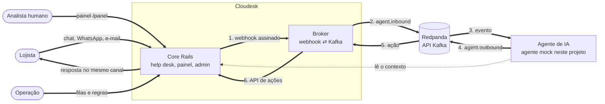

O agente de IA é um atendente da plataforma, como um analista: ele recebe conversas, lê o contexto e age por uma API. A diferença é o meio: o analista usa o painel; o agente recebe eventos pelo Kafka e devolve ações pelo Kafka.

| Aspecto | Definição |
| - | - |
| Forma | Um app Rails organizado por contextos de negócio; o broker é um papel de processo do mesmo código; agente mock e simulador de canais são serviços Python à parte |
| Estado | Um único PostgreSQL: dados, fila de jobs, tempo real e cache |
| Mensageria | Redpanda (API Kafka) entre plataforma e agente |
| Escala | Mesma imagem, processos separados por papel, escalados de forma independente |
| Empacotamento | Docker Compose, self-hosted, sobe com um comando |

### Princípios

| Princípio | O que significa na prática |
| - | - |
| **Um único sistema de estado** | Todo o estado vive no Postgres, inclusive a fila de jobs, o tempo real e o cache; não existe Redis e não existe dual-write. Um commit no banco é a única fonte de verdade |
| **Atomicidade na origem** | Mensagem, auditoria e job de saída são gravados na mesma transação: ou os três existem, ou nenhum existe |
| **Toda decisão é auditada** | Cada decisão gera um `audit_event` com payload completo, regra e versão que a produziram |
| **Escala por papel, não por serviço** | Um código, vários tipos de processo, cada um com réplicas conforme a própria carga |
| **Infraestrutura proporcional ao problema** | Cada componente existe porque um requisito do enunciado ou uma hipótese do experimento depende dele |

### Glossário

| Termo | Significado no Cloudesk |
| - | - |
| Marca (brand) | Tenant: InfinitePay ou JIM. Todo dado de domínio pertence a uma marca |
| Lojista (contact) | Cliente final que abre o atendimento |
| Conversa | Um atendimento, com estado, fila, atendente e mensagens numeradas |
| `sequence` | Número da mensagem dentro da conversa (1, 2, 3...), sem buracos |
| Atendente | Quem responde: a IA (`ai`) ou um analista (`human`) |
| Fila e regra | A fila tem SLA e capacidade; a regra decide a fila, a prioridade e o SLA de cada conversa |
| Handoff | Passagem da conversa da IA para um analista, com motivo, resumo e contexto |
| Core | O app Rails: canais, conversas, roteamento, painel, API do agente e auditoria |
| Broker | Ponte entre o Core e o Kafka, nos dois sentidos, sem acesso ao banco |
| Evento | O que o Core manda ao agente (`message.created`) |
| Ação | O que o agente devolve (`reply`, `escalate`, `categorize`, `resolve`) |
| `Idempotency-Key` | Chave de cada ação; a mesma chave processada duas vezes tem efeito uma vez só |
| Outbox | Job gravado na mesma transação do dado; garante que nada sai sem o dado e nada se perde depois do commit |
| RLS | Row-Level Security do Postgres: cada consulta vê só as linhas da marca corrente |
| DLQ | Tópico `agent.dlq`, para onde vão as ações que não podem ser aplicadas |
| `traceparent` | Identificador W3C que acompanha a mensagem em cada salto e liga a linha do tempo |

### Premissas de volume

"Milhares de atendimentos novos por dia" é traduzido nos alvos abaixo. Os números são premissas do projeto, não dados da CloudWalk.

| Parâmetro | Premissa | Como chegamos |
| - | - | - |
| Atendimentos novos por dia | 50.000 | Limite superior adotado para "milhares/dia" |
| Mensagens por atendimento | 10 | Cliente + atendente, ida e volta |
| Mensagens por dia | 500.000 | 50.000 × 10 |
| Média em horário comercial | \~8 msg/s | 70% do volume em 12 h |
| Pico sazonal | \~80 msg/s | 10× a média (Black Friday, incidente de Pix, dia de repasse) |
| Meta sustentada de projeto | 250 msg/s por 15 min | \~3× o pico, como margem |
| Latência interna (entrada → tópico Kafka) | p95 < 300 ms | Exclui o tempo de "raciocínio" do agente |
| Latência ponta a ponta (entrada → resposta no canal) | p95 < 1 s | Descontada a latência artificial do agente; 1 s é o limite em que a espera não interrompe o fluxo de quem conversa |
| Mensagens perdidas ou duplicadas para o cliente | 0 | Mesmo com falhas e reentregas |

**Unidade:** "msg/s" conta mensagens de entrada do lojista por segundo. Cada mensagem de entrada gera, no processo `web`, três requisições: o POST do canal, o GET de contexto feito pelo agente e o POST da ação do agente. A 250 msg/s, o `web` atende cerca de 750 req/s, além da entrega da resposta ao canal e dos broadcasts de tempo real.

Essas metas são as hipóteses do experimento técnico.

## Arquitetura

### Contêineres e processos

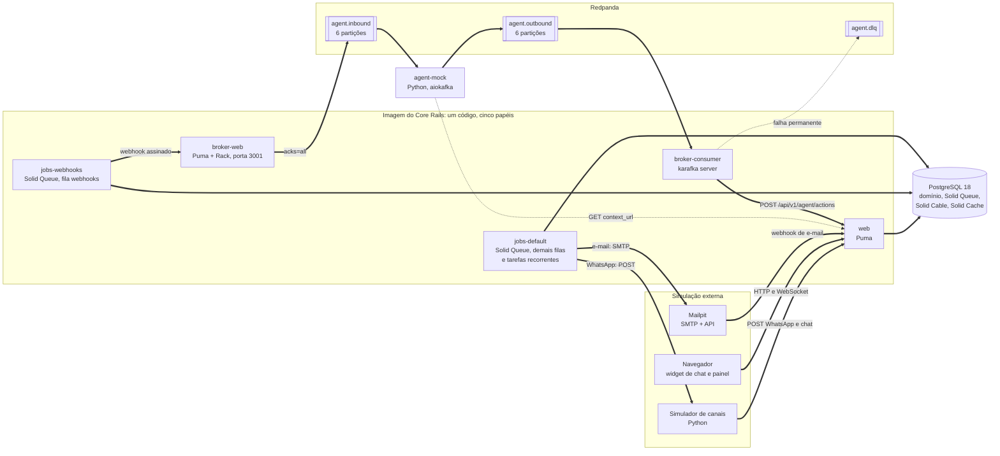

Os processos `broker-web` e `broker-consumer` não têm seta para o PostgreSQL: o Broker não acessa o banco e fala com o Core somente por HTTP. O chat chega ao lojista por Turbo Stream, pelo Solid Cable, no WebSocket que o `web` mantém com o navegador.

### Componentes

| Componente | Tecnologia | Responsabilidade |
| - | - | - |
| Core Help Desk | Rails 8 (API + Hotwire), módulos Channels, Conversations, Routing, Agents, Audit, Admin | Regras de negócio, API, chat, painel e admin |
| Banco | PostgreSQL 18 | Atendimentos, mensagens, filas, regras, auditoria, jobs, tempo real e cache |
| Jobs | Solid Queue, no mesmo banco do app | Entrega de webhooks, varredura do timeout do agente, atualização do painel, resumos de memória |
| Tempo real | Action Cable / Turbo Streams sobre Solid Cable | Chat e painel do analista ao vivo |
| Cache | Solid Cache | Cache de contexto e de regras compiladas |
| E-mail de entrada | Action Mailbox + Mailpit | Canal de e-mail simulado |
| Broker | Karafka + endpoint Rack, no mesmo código e imagem do Core | Webhook → Kafka e Kafka → API de ações |
| Mensageria | Redpanda (compatível com a API Kafka) | `agent.inbound` e `agent.outbound`, com 6 partições cada, e `agent.dlq` |
| Agente mock | Python | Consome, lê contexto, chama ferramentas falsas, publica ação |
| Simulador de canais | Python | Gera tráfego dos três canais e recebe as respostas |
| Observabilidade | Prometheus + Grafana | Métricas, cockpit operacional e alertas |

O Broker compartilha código com o Core (schemas do contrato, assinatura HMAC), mas não acessa o banco: fala com o Core somente por HTTP, nos dois sentidos, como na estrutura de referência.

### Mapa do código do Core

O Core é dividido em módulos por contexto de negócio, em `core/app/modules/`. O diagrama mostra quem chama quem nos caminhos principais.

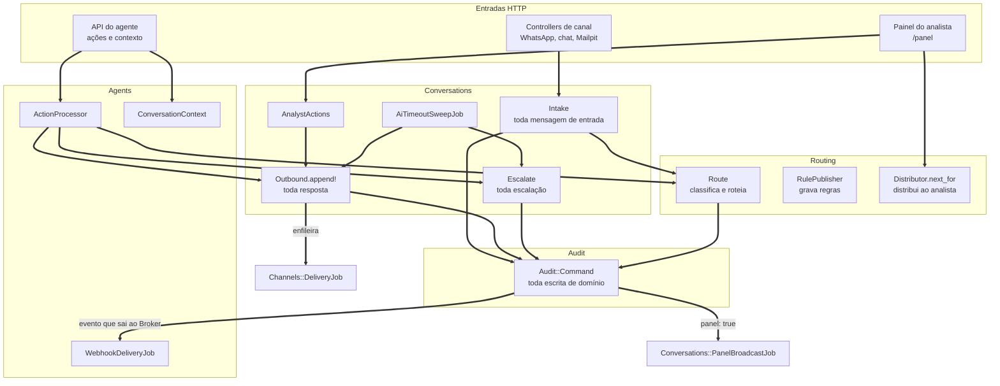

Três funis concentram as regras: toda entrada passa por `Conversations::Intake`, toda resposta por `Conversations::Outbound.append!` e toda escrita de domínio por `Audit::Command`. Com isso, auditoria, outbox e isolamento por marca são garantidos em um lugar só, e não em cada chamador.

### Processos

O monólito é um único código que roda em processos distintos, cada um escalado de forma independente pelo número de réplicas no Compose. A falha de um papel não derruba os outros.

| Serviço | Comando | Escala conforme |
| - | - | - |
| `web` | Puma | requisições HTTP e conexões WebSocket |
| `jobs-webhooks` | Solid Queue, só a fila `webhooks` | volume de saída para o broker |
| `jobs-default` | Solid Queue, demais filas: varredura do timeout do agente a cada 15 s, entregas aos canais, atualização do painel, memória e manutenção | backlog de tarefas internas |
| `broker-web` | Puma com o endpoint Rack do Broker | volume de webhooks vindos do Core |
| `broker-consumer` | `karafka server` | número de partições de `agent.outbound` |
| `agent-mock` | `agent-mock run`, consumidor Python no grupo `cloudesk-agent` | número de partições de `agent.inbound` |

Contêineres do ambiente completo: PostgreSQL, Redpanda, Mailpit, `web`, `jobs-webhooks`, `jobs-default`, `broker-web`, `broker-consumer`, `agent-mock`, simulador de canais, Prometheus e Grafana. O k6 roda só durante o experimento.

#### Filas de jobs e tarefas recorrentes

Os jobs ficam em tabelas do Solid Queue no mesmo PostgreSQL. A fila `webhooks` tem um processo só para ela, para que a saída ao Broker não dispute workers com o restante.

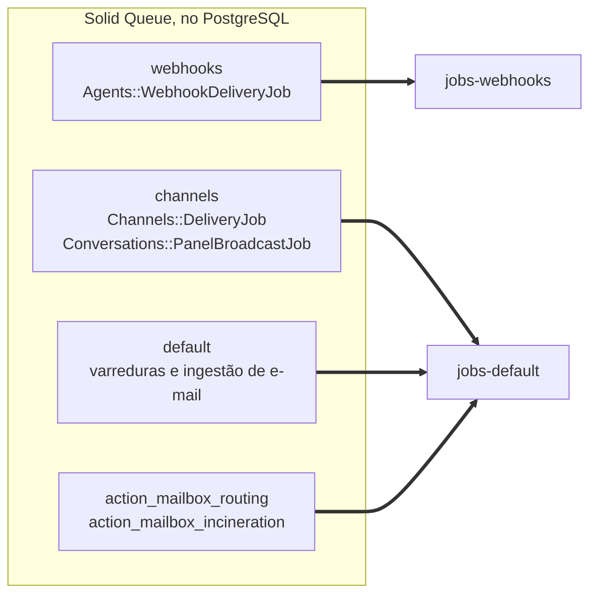

| Tarefa recorrente | Job | Frequência | O que faz |
| - | - | - | - |
| `ai_timeout_sweep` | `Conversations::AiTimeoutSweepJob` | a cada 15 s | Mensagem de espera ou escalação das conversas da IA sem resposta |
| `close_expired_conversations` | `Conversations::CloseExpiredJob` | a cada minuto | Fecha as conversas `resolved` com prazo de reabertura vencido |
| `sweep_mailpit` | `Channels::Email::SweepJob` | a cada minuto | Traz do Mailpit os e-mails que o webhook perdeu |
| `recover_interrupted_webhooks` | `Agents::RecoverInterruptedWebhooksJob` | a cada minuto | Devolve à fila os jobs de webhook interrompidos pela morte do worker |

### Fluxo de uma mensagem

1. O canal simulado chama o webhook de entrada; o Core normaliza para o envelope canônico.
2. A triagem define categoria e urgência; o Routing avalia as regras e atribui ao atendente IA da fila.
3. Numa única transação, o Core grava a mensagem, a classificação, o roteamento, os `audit_events` e, com a conversa atribuída à IA, o job de webhook no Solid Queue.
4. O worker `jobs-webhooks` envia o webhook `message.created` assinado ao Broker.
5. O Broker valida a assinatura, publica em `agent.inbound` com chave `conversation_id` e responde 2xx **somente depois da confirmação do Kafka**. Sem confirmação, responde erro e o Solid Queue reenvia.
6. O agente mock consome, lê o contexto na `context_url`, consulta ferramentas falsas e publica a ação em `agent.outbound`.
7. O Broker consome e chama a API de ações do Core com `Idempotency-Key` e assinatura HMAC.
8. O Core confere o estado da conversa e o `based_on_sequence`, grava a resposta, entrega no canal e atualiza a tela; em `escalate`, cria o Handoff e roteia para a fila humana.

O diagrama abaixo mostra o mesmo caminho para uma mensagem de WhatsApp ou chat, no caso feliz. Os números seguem a ordem dos acontecimentos.

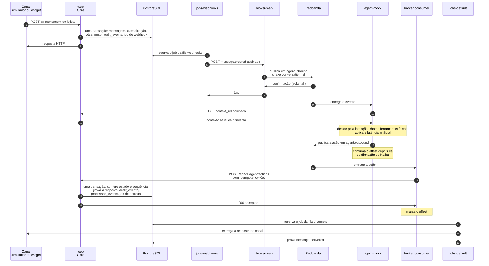

O e-mail entra por outro caminho até o `Conversations::Intake` (ver [Componentes simulados](#componentes-simulados)); daí em diante, o fluxo é o mesmo.

## Domínio

### Modelo de domínio

O agente de IA é modelado como um **atendente** igual ao humano (tipo `ai` ou `human`): ele atua como usuário da plataforma.

| Entidade | Papel |
| - | - |
| Brand | Marca/tenant (InfinitePay, JIM); escopo de todo dado |
| Team | Equipe de analistas, com skills e horário |
| Queue | Fila com SLA, capacidade, atendente inicial (IA ou humano) e fila de transbordo; no código, `Routing::Queue` |
| RoutingRule | Condição → fila + prioridade; versionada e auditada |
| Contact | Lojista sintético, com identidades por canal (telefone, e-mail, id do app) |
| Conversation | O atendimento e seu estado |
| Message | Mensagem com canal, autor (cliente, IA, analista, sistema) e sequência por conversa |
| Attendant | Humano ou IA; capacidade simultânea e skills |
| Handoff | Escalação com motivo, resumo e contexto estruturado |
| AuditEvent | Registro append-only de cada decisão, com payload completo |
| CustomerMemory | Resumo das interações anteriores do lojista |

As relações entre as tabelas, pelas chaves estrangeiras. Toda tabela de domínio também tem `brand_id`, e toda chave estrangeira entre tabelas de domínio inclui o `brand_id`; o diagrama omite a ligação de cada tabela com `brands` para ficar legível.

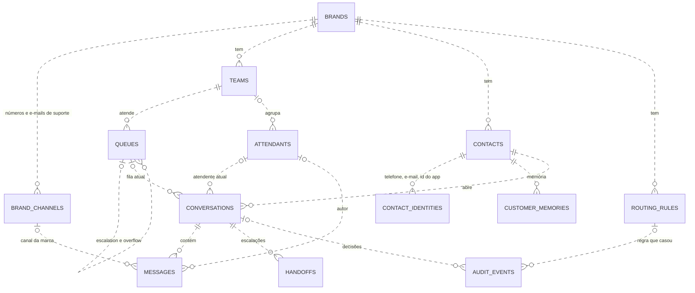

`processed_events` (registro de idempotência das ações do agente) também é tabela de domínio, ligada só à marca.

### Isolamento por marca

Todas as tabelas de domínio têm `brand_id`, com **Row-Level Security** no Postgres; a marca corrente é definida por transação e também segue no header Kafka. As migrações rodam com o papel dono das tabelas; a aplicação usa um papel sem privilégio de dono, para que o RLS e o bloqueio de escrita em `audit_events` valham para ela. As tabelas de infraestrutura (Solid Queue, Solid Cable e Solid Cache) não têm `brand_id` nem RLS, porque os workers processam jobs de todas as marcas; a marca de cada job segue nos argumentos dele. A tabela `brands` também fica fora do RLS, pois é lida para resolver a marca antes de ela ser definida na transação. O RLS é forçado (`FORCE ROW LEVEL SECURITY`): o papel dono também obedece às políticas e não é superusuário.

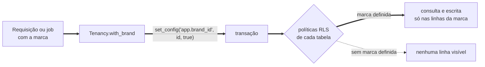

O `Tenancy.with_brand` é o único ponto do código que define a marca. Como o parâmetro vale só para a transação, uma conexão devolvida ao pool não carrega a marca de quem a usou antes.

Os identificadores (chaves primárias e `event_id`) são UUID v7, gerados pelo `uuidv7()` do PostgreSQL 18. O detalhamento do modelo de dados está em `documents/fases/02-banco-multi-marca-e-entidades.md`.

### Entrada de uma mensagem

Toda mensagem de entrada, de qualquer canal, passa por `Conversations::Intake`. Ele decide em qual conversa a mensagem entra e se ela precisa ser roteada.

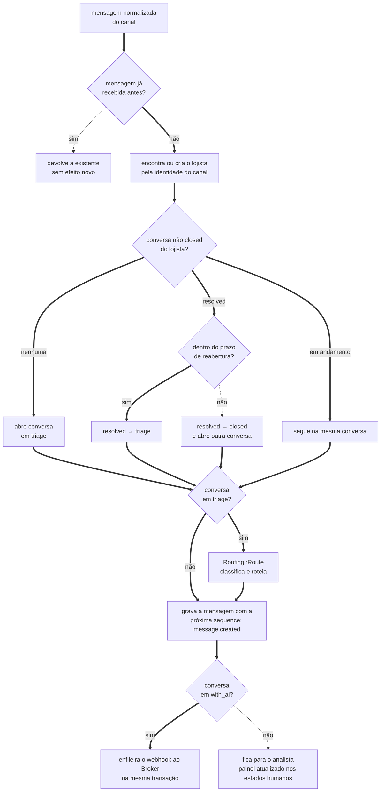

O lojista tem no máximo uma conversa não `closed`, em qualquer canal: se escreve no WhatsApp e depois por e-mail, as duas mensagens entram na mesma conversa.

### Filas configuráveis pela operação

Filas e regras são dados, não código: o operador cria e edita pelo painel administrativo, sem deploy. As regras são avaliadas em ordem; a primeira que casa define fila, prioridade e SLA.

```json
{
  "name": "InfinitePay · Repasse · Alto volume",
  "when": { "brand": "infinitepay", "category": "repasse", "segment": "alto_tpv" },
  "then": { "queue": "ip-financeiro-prioritaria", "priority": 90, "sla_minutes": 15, "first_attendant": "ai" }
}
```

- **Dimensões de condição:** marca, canal, categoria, prioridade, segmento do lojista, idioma, horário.
- **Triagem:** um classificador leve (regras + palavras-chave) define categoria e urgência na entrada; a condição de prioridade das regras compara com a urgência, e a prioridade numérica da conversa vem da regra. O agente pode reclassificar durante a conversa, o que dispara novo roteamento.
- **Distribuição:** atribuição por capacidade com `SELECT … FOR UPDATE SKIP LOCKED` no Postgres, evitando que dois atendentes peguem o mesmo caso.
- **Toda edição de regra gera uma nova versão** e um evento de auditoria com autor, diff e horário.

O roteamento de uma conversa em `triage`, passo a passo:

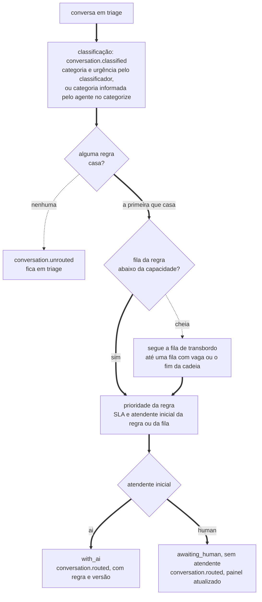

O `categorize` do agente leva a conversa de `with_ai` a `triage` e a roteia de novo com a categoria informada. O detalhamento da triagem, do roteamento e da distribuição está em `documents/fases/07-triagem-roteamento-e-distribuicao.md`.

### Contrato com o agente (webhooks + Kafka)

O Core e o agente não se chamam diretamente para entregar eventos e ações: o Broker faz a ponte com o Kafka. Na ida, o Core envia um **evento**; na volta, o agente envia uma **ação**.

```json
{
  "event_id": "01a1d5f0-…",
  "type": "message.created",
  "brand": "infinitepay",
  "conversation_id": "01a1d5e8-…",
  "sequence": 7,
  "received_at": "2026-11-13T14:02:11.482Z",
  "message": { "author": "customer", "channel": "whatsapp", "text": "Meu repasse de ontem não caiu" },
  "context_url": "/api/v1/agent/brands/infinitepay/conversations/01a1d5e8-…/context",
  "traceparent": "00-4bf9…-00f0…-01"
}
```

- **Assinatura na ida:** o webhook Core → Broker leva HMAC-SHA256 com timestamp no header; reenvios antigos são rejeitados (anti-replay).
- **Assinatura na volta:** as chamadas do Broker à API de ações do Core (`POST /api/v1/agent/actions`) e a leitura da `context_url` pelo agente (`GET /api/v1/agent/brands/<brand>/conversations/<conversation_id>/context`) usam o mesmo esquema de HMAC-SHA256 com timestamp.
- **Segredos:** cada chamada tem o seu: `BROKER_WEBHOOK_SECRET` no webhook, `AGENT_ACTIONS_SECRET` na API de ações e `AGENT_CONTEXT_SECRET` na leitura do contexto. A marca fica no caminho da `context_url` e entra na assinatura, porque o RLS exige a marca antes da leitura da conversa.
- **Formato da assinatura:** HMAC-SHA256 de `<timestamp>.<MÉTODO>.<caminho>.<corpo>`, nos headers `X-Cloudesk-Timestamp` e `X-Cloudesk-Signature`, com janela de 300 segundos.
- **Contrato versionado:** os schemas, exemplos e vetores ficam em `contracts/v1/`; o detalhamento está em `documents/fases/04-contrato-de-integracao.md`.
- **Ações do agente** (tópico de saída): `reply`, `escalate`, `categorize`, `resolve` e o registro das ferramentas consultadas. Toda ação leva `based_on_sequence`, a sequência da última mensagem que o agente considerou. O Broker envia o valor Kafka da ação, sem alteração, a um endpoint único da API de ações; marca e conversa vêm do corpo assinado.
- **Entrega:** at-least-once em todo o caminho + idempotência no Core = efeito exactly-once para o cliente.
- **Falhas:** retries com backoff exponencial, com jitter no webhook de ida (Solid Queue) e pela pausa do Karafka, sem jitter, na volta; tópico DLQ para mensagens problemáticas, preservando chave, headers e payload originais, com headers de diagnóstico (schema `kafka.dlq-headers`), e reprocessamento pelo painel.

As três chamadas assinadas:

| Chamada | Quem assina | Quem confere | Segredo |
| - | - | - | - |
| Webhook `message.created` | `jobs-webhooks` | `broker-web` | `BROKER_WEBHOOK_SECRET` |
| Ação do agente | `broker-consumer` | `web` (API de ações) | `AGENT_ACTIONS_SECRET` |
| Leitura do contexto | `agent-mock` | `web` (API de contexto) | `AGENT_CONTEXT_SECRET` |

O que cada ação faz quando é aceita:

| Ação | Efeito na conversa | Mensagem ao lojista |
| - | - | - |
| `reply` | Nenhum; a conversa segue em `with_ai` | Sim, responde à última mensagem do lojista com `sequence` menor ou igual ao `based_on_sequence` |
| `escalate` | `with_ai` → `awaiting_human`, com Handoff | Não |
| `categorize` | `with_ai` → `triage` e novo roteamento | Não |
| `resolve` | `with_ai` → `resolved`, com `resolved_at` | Não |

#### Ordem das mensagens

A chave da partição Kafka é o `conversation_id`, o que preserva a ordem em que os eventos chegam ao Kafka. Antes do Kafka, cada evento é um job do Solid Queue, e workers paralelos com retry podem entregar eventos da mesma conversa fora de ordem. Por isso a ordem não depende do transporte:

- o agente sempre decide sobre o estado mais recente da conversa, lido na `context_url`;
- se o contexto traz uma mensagem do lojista com sequência maior que a do evento recebido, o agente descarta o evento, pois o evento da mensagem mais nova produz a resposta;
- o `sequence` do evento serve para detectar atraso, não para reconstruir a conversa.

Exemplo: o lojista envia as mensagens 7 e 8 em seguida, e o evento da 8 chega ao agente antes do evento da 7.

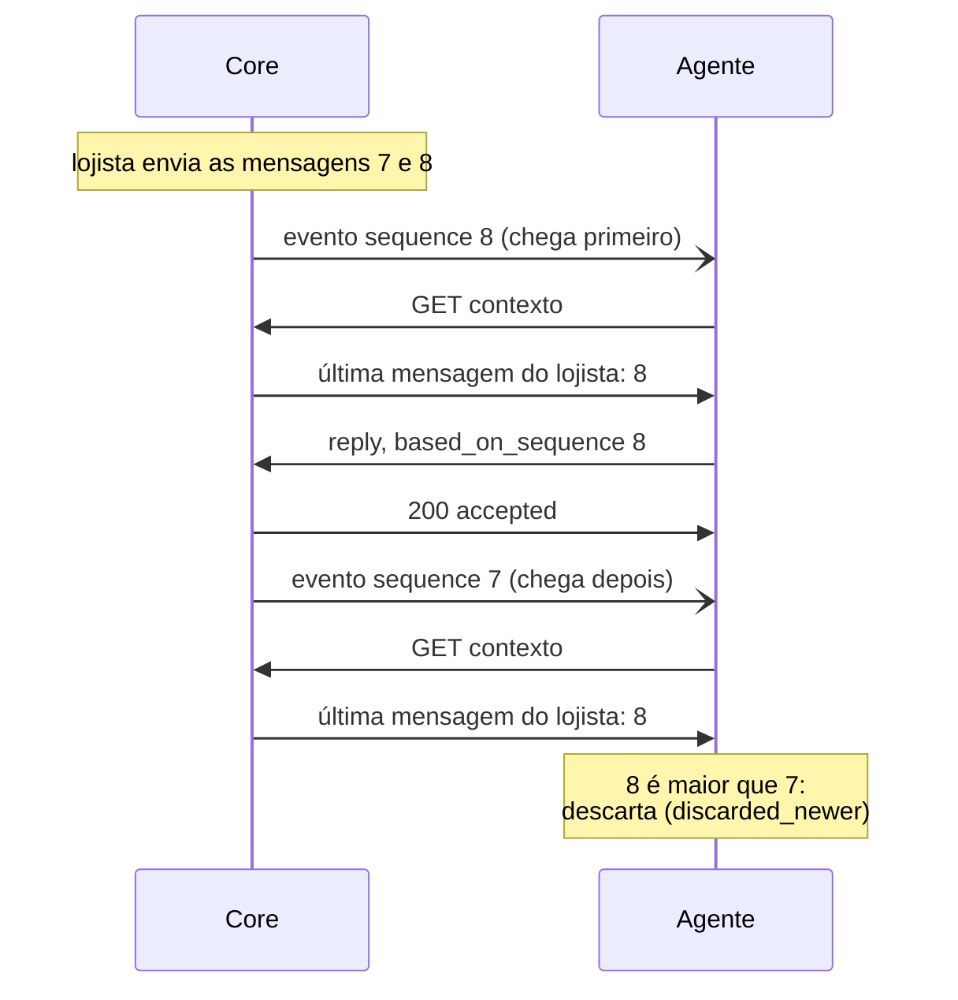

Se o agente já tivesse lido o contexto antes da mensagem 8 e publicasse uma ação com `based_on_sequence` 7, o Core a recusaria com `409 stale` (ver [Ação sobre contexto desatualizado](#ação-sobre-contexto-desatualizado)).

#### Idempotência

- A `Idempotency-Key` de cada ação é derivada do `event_id` de entrada e do tipo da ação, no formato `<inbound_event_id>:<type>`. O Broker a calcula a partir do corpo da ação. Um evento reentregue ao agente produz a mesma chave.
- O Core mantém a tabela de eventos processados, com `brand_id`, RLS e índice único em `(brand_id, idempotency_key)`; a segunda ação com a mesma chave não produz efeito e devolve o corpo e o código da primeira. A aceitação e as duas recusas com `409` (`stale` e `rejected`) são resultado final da chave.
- As ações da mesma conversa são processadas com a linha da conversa travada (`FOR UPDATE`), o que serializa inclusive as duplicadas simultâneas.
- O Core é a única barreira de deduplicação. O agente não guarda estado, o que permite reiniciá-lo e rodar várias instâncias.

Exemplo: o `broker-consumer` cai depois de o Core aceitar a ação e antes de marcar o offset, e lê a mesma ação de novo ao voltar.

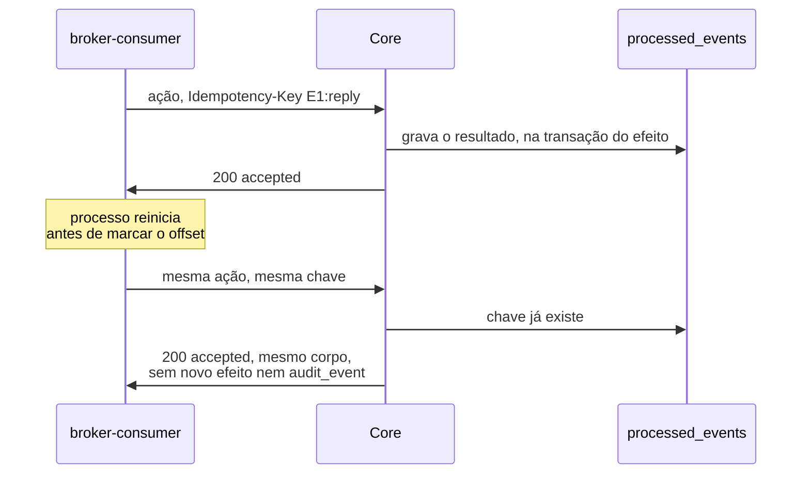

#### Como o Core processa uma ação

Toda ação passa por `Agents::ActionProcessor`, em um único `Tenancy.with_brand`. As conferências seguem esta ordem:

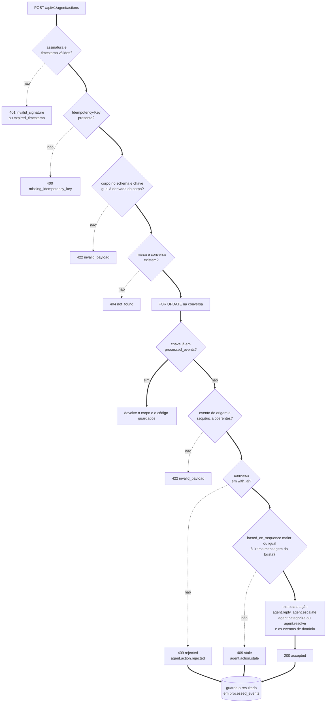

`accepted`, `stale` e `rejected` ficam guardados como resultado final da chave; `invalid_payload` e `not_found` não ficam.

#### Como o Broker trata a resposta do Core

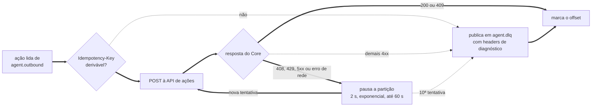

#### Ação sobre contexto desatualizado

- O Core compara `based_on_sequence` com a última mensagem do lojista na conversa. Se existe mensagem mais nova, a ação é rejeitada com `409` e a rejeição gera `audit_event`.
- O Broker trata `409` como resultado final: não reenvia e não manda para a DLQ.
- A resposta ao lojista vem da ação gerada pelo evento da mensagem mais nova.
- Uma mensagem do lojista conta como atendida quando existe uma ação aceita com `based_on_sequence` maior ou igual à sequência dela. Essa é a definição usada na reconciliação do experimento.

#### Ação com a conversa fora da IA

- O Core aceita ação do agente só com a conversa em `with_ai`. Com a conversa em outro estado (por exemplo, assumida por um analista ou resolvida), a ação é rejeitada com `409` e status `rejected`, com o estado da conversa, e a rejeição gera `audit_event`. O Broker trata esse `409` como resultado final, como o da ação desatualizada.
- A conferência do estado vem antes da conferência de `based_on_sequence`.
- A comparação de `based_on_sequence` não cobre esse caso: a conversa pode mudar de estado sem mensagem nova do lojista, e a ação chega com a sequência em dia.
- O job de webhook confere o estado antes de enviar e não envia com a conversa fora de `with_ai`. A conferência evita trabalho do agente, mas não fecha a corrida entre o envio e a ação; a barreira é a rejeição no Core.

#### Timeout do agente

Um job recorrente (`Conversations::AiTimeoutSweepJob`), a cada 15 segundos no `jobs-default`, varre as conversas em `with_ai` pela última mensagem do lojista. Não existe timer por mensagem.

- **Metade do SLA:** sem mensagem da IA nem do sistema depois da última mensagem do lojista, a plataforma envia uma mensagem de espera (autor `system`, no locale da marca, pelo canal da mensagem do lojista), uma vez por mensagem do lojista.
- **SLA inteiro:** sem mensagem da IA depois da última mensagem do lojista, a conversa é escalada com handoff de motivo `ai_timeout`, resumo do sistema e contexto vazio, com ator `system`. A mensagem de espera não reinicia o prazo.
- O SLA é o `sla_minutes` da conversa, definido no roteamento. Um `categorize` aceito não grava mensagem e não conta como resposta.
- As conversas são travadas com `FOR UPDATE SKIP LOCKED`: a conversa travada por uma ação do agente fica para a execução seguinte, e as condições são conferidas de novo depois da trava. Uma ação da IA que chega depois da escalação recebe `409 rejected`.

A linha do tempo de uma mensagem do lojista sem resposta da IA:

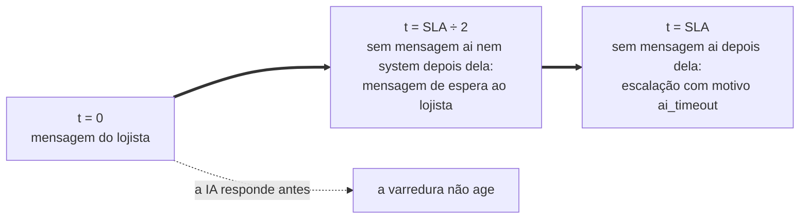

Como a varredura roda a cada 15 segundos, cada passo acontece até 15 segundos depois do instante marcado.

### Handoff com resumo e contexto

Na ação `escalate`, o agente envia motivo, resumo curto e contexto estruturado: intenção, entidades (ex.: id da transação sintética), ferramentas consultadas e seus retornos, tentativas feitas, sentimento, próximo passo sugerido e confiança. A plataforma grava o Handoff com esses dados e leva a conversa de `with_ai` a `awaiting_human`, sem atendente, na fila de escalação da fila em que ela estava (`queues.escalation_queue_id`, uma fila humana da mesma marca), com a prioridade mantida e o SLA da fila de destino; sem fila de escalação, a conversa fica na mesma fila. O painel dos analistas da equipe é atualizado em tempo real, e o histórico completo segue na mesma conversa. A escalação passa sempre por `Conversations::Escalate`, chamado pelo `escalate` do agente e pela varredura do timeout.

Do pedido de escalação até a resolução pelo analista:

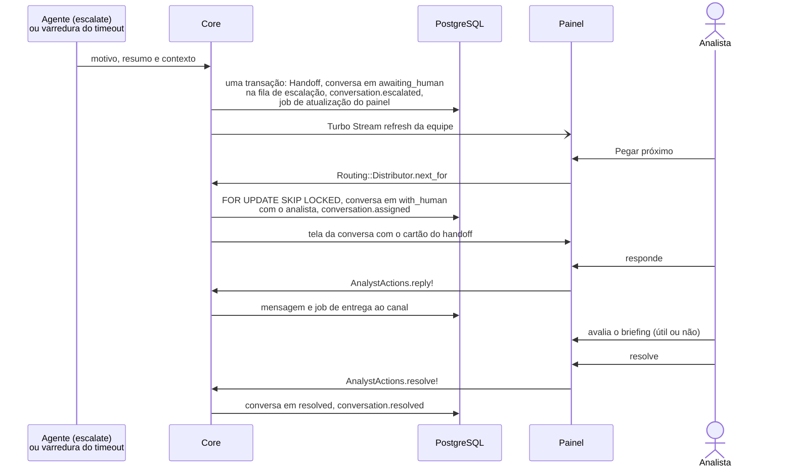

### Ciclo de vida do atendimento

| Estado | Significado |
| - | - |
| `triage` | Entrou ou reabriu; aguarda classificação e roteamento |
| `with_ai` | Atribuída ao atendente IA |
| `awaiting_human` | Escalada; na fila humana, sem analista |
| `with_human` | Analista assumiu |
| `resolved` | Resolvida; dentro do prazo de reabertura |
| `closed` | Prazo de reabertura vencido; estado final |

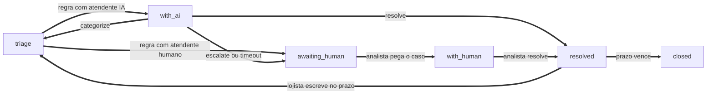

Toda transição gera um evento de auditoria; uma conversa resolvida volta à triagem se o lojista escrever de novo dentro do prazo de reabertura. Vencido o prazo, a conversa passa a `closed` e uma nova mensagem do lojista abre outra conversa. As transições válidas ficam em um único lugar, `Conversation::TRANSITIONS`.

### Painel do analista

O painel (`/panel`, Hotwire) fica atrás de HTTP basic auth (`PANEL_USER` e `PANEL_PASSWORD`; sem os dois preenchidos, o acesso é negado). O login é simulado: a pessoa escolhe a marca e um analista humano com equipe, e a escolha fica na sessão. O analista é o ator dos eventos que grava.

- **Fila de escalas:** conversas em `awaiting_human` nas filas da equipe, por prioridade e tempo na fila, com motivo e resumo do handoff, tempo na fila e SLA restante; as conversas do analista e a capacidade usada.
- **Pegar próximo:** o analista recebe o próximo caso pela distribuição por capacidade (`Routing::Distributor.next_for`); a fila é visível, e cada conversa abre só para leitura até ser atribuída.
- **Tela da conversa:** histórico, cartão do handoff, "Por que caiu aqui?", conversas anteriores do lojista em todos os canais e a memória do lojista, quando existe.
- **Ações:** responder pelo canal da última mensagem do lojista, resolver (`with_human` → `resolved`) e avaliar o briefing (`Conversations::AnalystActions`).
- **Tempo real:** as mudanças que aparecem no painel são gravadas com `panel: true` no `Audit::Command`, que enfileira o `Conversations::PanelBroadcastJob` na mesma transação. O job envia um Turbo Stream `refresh` ao stream da equipe e ao da conversa, e a página recarrega com morph.

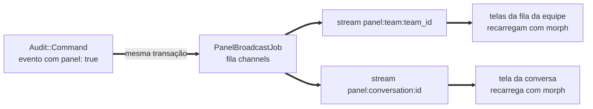

O job só avisa que algo mudou; ele não lê o domínio. Cada tela busca de novo o próprio conteúdo, já com as permissões e a marca de quem a vê.

### Auditoria e rastreabilidade

- `audit_events` append-only: ator, ação, alvo, antes/depois, payload do evento, motivo, regra e versão que casou, `trace_id`.
- `UPDATE` e `DELETE` bloqueados por permissão de banco e trigger.
- `traceparent` (W3C) propagado em headers HTTP e Kafka, ligando cada salto da mensagem.
- **Linha do tempo por mensagem:** cada salto carimba seu horário e o repassa adiante. O Broker registra o recebimento do webhook no header da mensagem, e o timestamp do registro Kafka marca a gravação no tópico; o agente devolve esses dois carimbos e os seus próprios (consumo, ferramentas, publicação) na ação. O Core grava tudo no `audit_event` da ação.
- **Evento próprio de cada ação:** cada ação aceita grava `agent.reply`, `agent.escalate`, `agent.categorize` ou `agent.resolve`, com o corpo completo da ação (ferramentas, `model`, carimbos), a `Idempotency-Key` e o `received_at` do Core; os eventos de domínio da ação são gravados à parte, na mesma transação. As recusas gravam `agent.action.stale` e `agent.action.rejected`. O painel monta a linha do tempo canal → Core → Broker → Kafka → agente → Broker → cliente a partir de `audit_events` e `trace_id`, sem serviço de tracing externo.

Toda escrita de domínio passa por `Audit::Command`, que junta, na mesma transação, a mudança, o registro de auditoria e os jobs que dependem dela:

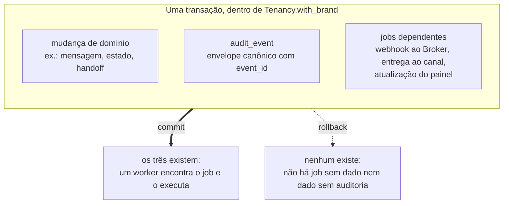

Os carimbos de horário que formam a linha do tempo de uma mensagem:

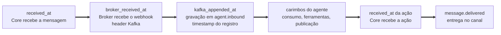

### Memória e contexto

- **Da conversa:** histórico completo disponível ao agente via `context_url`.
- **Do lojista:** resumo das conversas anteriores, atualizado no encerramento e entregue no contexto da próxima.
- **Entre canais:** identidades do mesmo lojista unificadas, para que WhatsApp e e-mail compartilhem histórico.

### Componentes simulados

- **Canais:** WhatsApp com payloads no formato da Cloud API da Meta; e-mail via Mailpit (SMTP local); chat in-app como widget web. Cada marca tem números de WhatsApp e e-mails de suporte próprios, na tabela `brand_channels`, e o chat leva a marca na URL.
- **Entrada do e-mail:** o webhook do Mailpit avisa o Core de cada e-mail recebido; o Core baixa o original pela API do Mailpit e cria o `InboundEmail` do Action Mailbox só quando o e-mail é endereçado a um e-mail de suporte de uma marca. Um job recorrente busca no Mailpit os e-mails sem tag e recupera o que o webhook perde. A resposta sai por SMTP para o Mailpit. O detalhamento está em `documents/fases/05-canais-de-entrada-e-identidade.md`.
- **Simulador de canais:** envia mensagens sintéticas nos três formatos e recebe as respostas de saída, registrando cada uma para a reconciliação. O detalhamento está em `documents/fases/06-simulador-de-canais.md`.
- **Agente mock:** consumidor Python de `agent.inbound`, sem estado, que publica uma ação por evento (`reply`, `escalate` ou `resolve`) em `agent.outbound`. A intenção sai de uma tabela de palavras-chave por locale; as ferramentas falsas (`consultar_transacao`, `consultar_repasse`, `consultar_taxas`, `status_maquininha`) devolvem um retorno derivado do SHA-256 da entrada, então a mesma mensagem gera sempre a mesma ação. Antes de decidir, o agente lê o contexto na `context_url` e descarta o evento quando o contexto tem mensagem do lojista mais nova ou a conversa não está em `with_ai`. A latência artificial é fixa (`AGENT_LATENCY_MS`) e entra antes da publicação. Os eventos de uma conversa são processados em série e os de conversas diferentes em paralelo, até `AGENT_CONCURRENCY` por processo. Modos de falha configuráveis (ver Diferenciais). O detalhamento está em `documents/fases/11-agente-mock.md`.
- **Dados sintéticos:** lojistas, transações e conversas gerados com seeds fixas (Faker pt\_BR e en\_US), sem nenhum dado real. Rodar as seeds de novo no mesmo banco não duplica registros.

Caminho do e-mail até o `Conversations::Intake`:

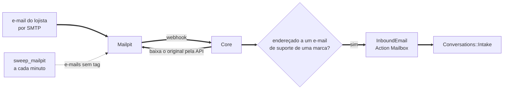

Decisão do agente mock para cada evento:

```mermaid
flowchart TB
    EV["evento de agent.inbound"] ==> V{"evento válido?"}
    V -.->|"não"| D1["descarta: invalid_event"]
    V ==> BL{"marca com locale<br/>configurado?"}
    BL -.->|"não"| D2["descarta: unknown_brand"]
    BL ==> CX["GET context_url assinado"]
    CX -.->|"rede, timeout, 408, 429, 5xx:<br/>repete com backoff"| CX
    CX -.->|"401, 404, 422, demais 4xx"| D3["descarta: context_error"]
    CX ==> NW{"contexto tem mensagem do lojista<br/>mais nova que o evento?"}
    NW -.->|"sim"| D4["descarta: discarded_newer"]
    NW ==> SW{"conversa<br/>em with_ai?"}
    SW -.->|"não"| D5["descarta: discarded_state"]
    SW ==> DEC["intenção pelas palavras-chave do locale<br/>ferramentas falsas<br/>reply, escalate ou resolve"]
    DEC ==> LAT["latência artificial e<br/>modo de falha, quando afeta o evento"]
    LAT ==> PUB["publica em agent.outbound<br/>based_on_sequence = sequence do evento"]
    PUB ==> OFF["confirma o offset"]
    D1 ==> OFF
    D2 ==> OFF
    D3 ==> OFF
    D4 ==> OFF
    D5 ==> OFF
```

## Decisões de design

**Postgres como único sistema de estado.** Solid Queue, Solid Cable e Solid Cache guardam jobs, mensagens de tempo real e cache no Postgres. A fila tem retries, fila de falhas e painel (Mission Control - Jobs), e sobrevive a qualquer falha que o banco sobreviva.

**Outbox implícito.** O Solid Queue usa o **mesmo banco** do app (e não o banco separado `queue` padrão do Rails 8). Gravar a mensagem e enfileirar o webhook é atômico: se o processo cai após o commit, o job já está persistido; se a transação falha, não existe job. `enqueue_after_transaction_commit` não é usado, pois apenas adia o enfileiramento sem garantir atomicidade.

**Confirmação antes do 2xx.** O Broker só confirma o webhook depois que o Kafka confirma a publicação. Uma queda do Broker em qualquer ponto resulta em reenvio pelo Solid Queue, nunca em perda.

**Deduplicação em um único lugar.** A idempotência vive no Core, com chave derivada do evento de entrada. Broker e agente são processos sem estado.

**Ordem pelo estado, não pelo transporte.** O agente decide sobre o contexto mais recente e o Core rejeita ação desatualizada. O sistema é correto mesmo quando eventos da mesma conversa chegam fora de ordem.

**Broker como papel do mesmo código.** O contrato e a assinatura têm uma única implementação em Ruby, e o Broker segue como processo isolado, com fronteira HTTP.

**Broker em dois processos.** O Broker roda como `broker-web` e `broker-consumer`, da mesma imagem. O `broker-web` é um Puma que serve o endpoint Rack e publica em `agent.inbound`; o `broker-consumer` é o `karafka server`, que consome `agent.outbound` e chama a API de ações do Core. Cada sentido escala pela sua própria carga (volume de webhooks na ida, partições na volta), e a queda de um não interrompe o outro. Os dois rodam sem Rails e sem banco; o detalhamento está em `documents/fases/10-broker.md`.

**Rastreabilidade a partir da auditoria.** A linha do tempo de cada mensagem sai de `audit_events`, que o enunciado já exige. Métricas agregadas ficam no Prometheus.

**Escala por papel de processo.** Uma imagem, um repositório e um deploy, com `web`, workers e broker escalando separadamente conforme sua própria carga.

**Dimensionamento do Postgres.** Por mensagem de entrada, o banco recebe: a mensagem do lojista, a resposta do atendente, os `audit_events` de cada decisão, as linhas do job de webhook nas tabelas do Solid Queue (enfileiramento, reserva e conclusão), o registro de idempotência e os broadcasts do Solid Cable. O total de transações por segundo na meta de 250 msg/s é uma das medidas do experimento, não uma premissa.

- Índices parciais nas filas e nas conversas abertas.
- Aplicação conectada diretamente ao Postgres, com pool dimensionado por processo.

### Robustez

- **Reentrega:** tabela de eventos processados com índice único; duplicatas são descartadas no Core.
- **Ordem:** agente decide pelo contexto mais recente; o Core rejeita ação baseada em contexto desatualizado.
- **Broker ou Kafka fora do ar:** o Solid Queue reenvia com backoff; ao esgotar, o job vai para a fila de falhas com botão de reprocessar no painel.
- **Processo cai no meio da operação:** nada se perde, porque mensagem e job foram gravados na mesma transação e o Broker só confirma após o ack do Kafka.
- **Agente sem resposta:** a varredura do timeout envia a mensagem de espera na metade do SLA e escala para humano no SLA inteiro.
- **Picos:** `web` e `jobs-webhooks` escalam horizontalmente; webhooks em fila dedicada; limite de taxa por marca.

Onde cada falha é absorvida, salto a salto:

| Falha | Onde a mensagem fica | Quem tenta de novo | Por que não duplica |
| - | - | - | - |
| `web` cai antes do commit | Em lugar nenhum: a transação não acontece | O canal recebe erro ou fica sem resposta | Nada foi gravado |
| `web` cai depois do commit | Mensagem e job no PostgreSQL | O worker de `jobs-webhooks` encontra o job | O job é um só |
| Worker de `jobs-webhooks` morre no envio | Job no PostgreSQL | `recover_interrupted_webhooks` devolve o job à fila | O mesmo `event_id` gera a mesma `Idempotency-Key` |
| `broker-web` cai ou o Kafka não confirma | Job no PostgreSQL | Solid Queue, com backoff exponencial e jitter | Idem |
| `agent-mock` reinicia | Evento em `agent.inbound`, offset não confirmado | O agente lê de novo a partir do offset | Idem |
| `broker-consumer` reinicia | Ação em `agent.outbound`, offset não marcado | O Karafka lê de novo a partir do offset | `processed_events` devolve o resultado guardado |
| Core fora do ar para o Broker | Ação em `agent.outbound` | Pausa do Karafka, 2 s a 60 s, até 10 tentativas, depois DLQ | Idem |
| Agente não responde | Conversa em `with_ai` | `ai_timeout_sweep` envia a espera e escala | A escalação confere o estado com a conversa travada |

### Limites conhecidos

- O Postgres concentra todo o estado e é o gargalo esperado de escala.
- O isolamento entre marcas é lógico (`brand_id` + RLS), não físico.
- `messages` e `audit_events` são tabelas únicas, sem particionamento; o crescimento contínuo exige particionar (ver Evolução).
- Não há pooler de conexões; o número de processos é limitado pelas conexões do Postgres.
- A linha do tempo depende dos relógios dos contêineres, que no ambiente local são o mesmo relógio da máquina.

## Experimento técnico: carga + falhas

### Hipóteses

Cada hipótese é avaliada separadamente, para que o resultado de uma não esconda o de outra.

| # | Hipótese | Medida |
| - | - | - |
| H1 | A plataforma sustenta 250 msg/s de entrada por 15 min sem acúmulo crescente de backlog | Profundidade do Solid Queue e lag do Kafka ao longo do teste |
| H2 | Nessa carga, a latência da entrada até a confirmação do Kafka tem p95 < 300 ms | Do recebimento HTTP no Core (`received_at`) até o ack do Kafka no Broker |
| H3 | Com o broker reiniciado e um worker morto durante o teste, nenhuma mensagem é perdida nem duplicada para o cliente | Reconciliação entre mensagens enviadas e respostas recebidas |
| H4 | Nessa carga, a latência ponta a ponta tem p95 < 1 s, descontada a latência artificial do agente | Do recebimento HTTP no Core (`received_at`) até a entrega da resposta no canal, menos a latência artificial configurada no agente mock |

A H4 mede a latência que o lojista percebe; a H2 mede só o trecho interno até o Kafka.

### Método

- **Carga:** k6 chama diretamente os endpoints de entrada de WhatsApp e chat, em degraus de 1×, 3×, 10× e 30× a média. O e-mail é coberto por teste funcional, fora da carga.
- **Falhas:** `docker restart` no `broker-web` e no `broker-consumer` e `docker kill` em um worker `jobs-webhooks` em instantes definidos do teste.
- **Reconciliação:** cada mensagem enviada tem identificador único; o simulador de canais recebe as respostas de saída e as registra. Perdida é a mensagem do lojista sem ação aceita que a cubra (ver "Ação sobre contexto desatualizado"); duplicada é a resposta entregue mais de uma vez ao canal.
- **Métricas:** Prometheus coleta latência por salto, profundidade do Solid Queue, TPS e conexões do Postgres e lag de consumo do Kafka.
- **Análise:** pandas e Plotly, com as condições de cada execução registradas.

Onde a carga entra, onde as falhas são injetadas e onde a reconciliação acontece:

```mermaid
flowchart LR
    K6["k6<br/>WhatsApp e chat"] ==> WEB["web"]
    WEB ==> JW["jobs-webhooks"]
    JW ==> BW["broker-web"]
    BW ==> TIN[["agent.inbound"]]
    TIN ==> AG["agent-mock"]
    AG ==> TOUT[["agent.outbound"]]
    TOUT ==> BC["broker-consumer"]
    BC ==> WEB2["web<br/>API de ações"]
    WEB2 ==> JD["jobs-default<br/>entrega"]
    JD ==> SIM["simulador de canais<br/>registra as respostas"]

    X1(["docker kill"]) -.-> JW
    X2(["docker restart"]) -.-> BW
    X3(["docker restart"]) -.-> BC
```

### Limitações

- O gerador de carga roda na mesma máquina do sistema medido e disputa CPU com ele; os valores de latência são um limite pessimista para esse hardware e não se transferem para produção.
- Hardware local difere de produção; no Windows, os contêineres rodam sobre WSL2.
- O agente mock tem latência artificial e decisão determinística.
- A distribuição de mensagens é sintética.
- Um único Postgres e um único nó Redpanda.
- O canal de e-mail não participa da carga.

## Cobertura dos requisitos

| Requisito | Como é atendido |
| - | - |
| Multicanal simulado | Simulador de WhatsApp (formato Cloud API), e-mail via Mailpit, widget de chat; envelope canônico |
| Filas configuráveis e editáveis | Queue + RoutingRule como dados, editadas no admin, versionadas e auditadas |
| Interface de conversa | Chat web em tempo real entre cliente e atendente (IA ou analista) |
| Painel do analista | Fila de escalas, briefing do handoff, histórico completo e memória do lojista |
| Integração webhooks + broker | Webhooks assinados → Broker → Kafka → agente, e o caminho inverso |
| Triagem, priorização e distribuição | Classificador na entrada + regras + atribuição por capacidade; IA como primeiro nível |
| Handoff com resumo e contexto | Ação `escalate` com resumo e contexto estruturado; histórico preservado |
| Rastreabilidade e auditoria | `audit_events` imutável, linha do tempo por mensagem e `traceparent` em HTTP e Kafka |
| Memória e contexto | Histórico da conversa, resumo do lojista e identidade unificada entre canais |
| Agente simulado | Mock determinístico com ferramentas falsas |
| Experimento técnico | Quatro hipóteses, método e limitações descritos acima |
| Empacotamento self-hosted | Docker Compose com todos os serviços |

## Diferenciais

Cinco diferenciais fazem parte do escopo, escolhidos por esforço baixo e por aparecerem na demonstração.

**1. Briefing de handoff avaliado pelo analista**

O handoff chega como cartão na tela da conversa: problema em uma frase, o que a IA tentou, ferramentas e retornos, sentimento, próximo passo sugerido e confiança. O analista da conversa marca o briefing como útil ou não, uma vez (`handoffs.rating`, evento `handoff.rated`). O tempo até a primeira resposta humana é calculado na leitura, da criação do handoff até a primeira mensagem de analista, e aparece no cartão e no payload do `handoff.rated`.

**2. Cockpit operacional em tempo real**

Dashboard Grafana com profundidade por fila, casos em risco de SLA, taxa de contenção da IA, motivos de escalação (Pareto), lag do Kafka, backlog do Solid Queue e alertas.

**3. Disjuntor de IA**

Por fila ou marca, um botão no admin passa todas as novas conversas para humanos na hora. O acionamento gera `audit_event` com autor e motivo.

**4. "Por que caiu aqui?"**

Em cada conversa, a tela mostra a regra e a versão que definiram fila, prioridade e SLA, com o atendente inicial e a cadeia de transbordo; a classificação, com as palavras encontradas, a pontuação e a versão das listas; e, quando houve, a escalação, com a fila de origem e a de destino. A informação vem dos últimos `conversation.routed`, `conversation.classified` e `conversation.escalated` em `audit_events` (`Conversations::RoutingExplanation`). Reforça a rastreabilidade e as filas configuráveis.

**5. Modos de falha do agente mock**

Por configuração (`AGENT_FAILURE_MODE`: `delay`, `drop`, `duplicate` ou `stale`, com a fração dos eventos afetados em `AGENT_FAILURE_RATE`), o agente mock atrasa, não responde, publica a mesma ação duas vezes ou envia ação desatualizada. Cada modo exercita um caminho da plataforma: a varredura do timeout, a idempotência no Core e a rejeição com `409 stale`. Reforça a robustez diante de falhas e reentregas e permite demonstrá-la.

| Modo | O que o agente faz | Caminho exercitado na plataforma |
| - | - | - |
| `delay` | Soma `AGENT_FAILURE_DELAY_MS` à latência | Mensagem de espera e escalação por timeout |
| `drop` | Não publica a ação | Escalação por timeout |
| `duplicate` | Publica a mesma ação duas vezes | Idempotência no Core (`processed_events`) |
| `stale` | Publica com `based_on_sequence` menos 1 | Recusa com `409 stale` |

## Pontos em aberto

| # | Ponto | Afeta |
| - | - | - |
| 1 | Login e perfis dos operadores do admin | Autor das edições de regra na auditoria |

## Evolução

**Escala e operação**

- **Particionamento mensal** de `messages` e `audit_events`, com manutenção automática de partições.
- **PgBouncer** em modo `transaction` para o `web` e `session` para os workers, quando o número de processos exigir.
- **Réplica de leitura** com o multi-database do Rails para painel, histórico e relatórios.
- **Sharding por `brand_id`** e, depois, **células por marca**: isolamento físico e residência de dados.
- **Deploy com Kamal** em servidores próprios.
- **Tracing distribuído** com OpenTelemetry e Jaeger ou Tempo.
- **Laboratório de caos** com Toxiproxy: latência e queda de rede injetadas em cenários repetíveis.

**Eventos**

- **Tópico `helpdesk.events`** com os eventos de domínio, para consumidores de analytics, QA e copiloto lerem sem tocar no Core.
- **Replay de `audit_events`** reconstruindo tabelas de leitura, com checksum de verificação.
- **Auditoria à prova de adulteração:** cadeia de hash por conversa e verificador.

**Operação e filas**

- **Editor de filas com simulação:** dry-run da regra sobre as últimas N conversas, aprovação por duas pessoas e rollback.
- **Priorização dinâmica:** score com aging, risco de SLA, segmento e sentimento.
- **Simulador sazonal com personas** e incidentes injetáveis.
- **Guardrails por política e abertura automática do disjuntor** por taxa de erro ou de escalação.

**IA e atendimento**

- **Detecção de incidentes em massa** por agrupamento de mensagens recentes.
- **Copiloto do analista** após o handoff.
- **Memória semântica** com pgvector e casos similares.
- **Shadow mode e canário** de versões do agente.
- **Cloudesk como servidor MCP.**
- **Detecção do idioma do lojista** cujo idioma é desconhecido: pelo texto das mensagens com mais de um número mínimo de caracteres, pelos dados do perfil do lojista ou pelo idioma informado pelo navegador ou dispositivo. O lojista novo recebe o idioma da marca.

**Governança**

- **Privacidade por design:** mascaramento de dados pessoais antes do agente e dos logs, retenção por marca e crypto-shredding.
