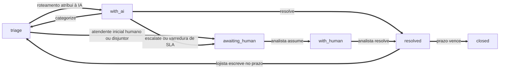

# Cloudesk · F1 · Banco, multi-marca e entidades

## Objetivo

A F1 fixa o modelo de dados do Cloudesk com todos os invariantes de banco: papéis, isolamento por marca, identificadores, entidades, máquina de estados da conversa, sequência de mensagens, auditoria append-only, idempotência e seeds.

Este documento detalha cada decisão e a fonte que a sustenta. O resumo está em `documents/arquitetura.md`, que prevalece; a lista de entregas e o critério de pronto estão em `contexto/ordem-de-implementacao.md`.

## Resumo das decisões

| Tema | Decisão |
| - | - |
| Versão do banco | PostgreSQL 18 |
| Identificadores | UUID v7, default `uuidv7()`, nas chaves primárias e no `event_id` |
| Papéis | Papel dono (migrações e seeds) e papel da aplicação (processos e testes); nenhum é superusuário |
| Isolamento | `brand_id` + Row-Level Security forçado (`FORCE`) em toda tabela de domínio |
| Marca corrente | `set_config('app.brand_id', <id>, true)`, por transação, em um único ponto do código |
| Formato do schema | `db/structure.sql` |
| Estados da conversa | `triage`, `with_ai`, `awaiting_human`, `with_human`, `resolved`, `closed` |
| Sequência de mensagens | Contador na conversa + índice único `(brand_id, conversation_id, sequence)` |
| Chaves estrangeiras | Compostas com `brand_id` entre tabelas de domínio, sem ação `ON DELETE` |
| `audit_events` | Append-only por permissão e por trigger |
| Eventos processados | Tabela de domínio, com `brand_id`, RLS e índice único `(brand_id, idempotency_key)` |
| Seeds | Faker com semente fixa; rodar de novo no mesmo banco não duplica registros |

## Papéis de banco

| Papel | Uso | Atributos | Permissões |
| - | - | - | - |
| Superusuário da imagem | Cria os dois papéis abaixo | Superusuário | Todas |
| Papel dono | Migrações e seeds | Sem superusuário, sem `BYPASSRLS` | Dono das tabelas |
| Papel da aplicação | `web`, `jobs-webhooks`, `jobs-default` e testes | Sem superusuário, sem `BYPASSRLS`, não é dono | Ver tabela seguinte |

Permissões do papel da aplicação:

| Tabelas | Permissões |
| - | - |
| Domínio (exceto `audit_events`) | `SELECT`, `INSERT`, `UPDATE`, `DELETE` |
| `audit_events` | `SELECT`, `INSERT` |
| `brands` | `SELECT` |
| Solid Queue, Solid Cable, Solid Cache | `SELECT`, `INSERT`, `UPDATE`, `DELETE` |
| `schema_migrations`, `ar_internal_metadata` | `SELECT` |
| Todas | Sem `TRUNCATE` |

Os dois papéis (`cloudesk_owner` e `cloudesk_app`) e os bancos são criados na F0, pelo script de inicialização do Postgres (`documents/fases/01-repositorio-e-infraestrutura-local.md`). A F0 também concede as permissões nas tabelas do Solid Queue, Solid Cable e Solid Cache e nas tabelas de controle de migração; a F1 entrega as permissões nas tabelas de domínio e o RLS.

As credenciais de cada papel chegam por variável de ambiente. Migrações e seeds rodam com as do papel dono; os processos da aplicação e os testes rodam com as do papel da aplicação.

**Embasamento.** A documentação do PostgreSQL afirma: "Superusers and roles with the BYPASSRLS attribute always bypass the row security system when accessing a table" e "Table owners normally bypass row security as well, though a table owner can choose to be subject to row security with ALTER TABLE ... FORCE ROW LEVEL SECURITY". Uma aplicação dona das tabelas ou superusuária não é contida pelo RLS; por isso ela usa um papel separado.

## Isolamento por marca

### Política

Toda tabela de domínio tem `brand_id` e a mesma política:

```sql
ALTER TABLE conversations ENABLE ROW LEVEL SECURITY;
ALTER TABLE conversations FORCE ROW LEVEL SECURITY;

CREATE POLICY brand_isolation ON conversations
  USING (brand_id = NULLIF(current_setting('app.brand_id', true), '')::uuid);
```

- A política não declara `WITH CHECK`; a mesma expressão vale para leitura e escrita, de modo que a aplicação não lê nem grava linha de outra marca.
- `current_setting('app.brand_id', true)` devolve `NULL` quando o parâmetro não existe, e o `NULLIF` trata o valor vazio da mesma forma. Com `NULL`, a comparação não casa nenhuma linha: sem marca definida, nada é visível.
- `FORCE` submete o papel dono às políticas. Se a aplicação ou os testes conectam com o papel dono por engano, o isolamento continua valendo.

**Embasamento.**

- "If no policy exists for the table, a default-deny policy is used, meaning that no rows are visible or can be modified."
- "The policy above implicitly provides a WITH CHECK clause identical to its USING clause."
- `current_setting`: "If there is no such setting, current_setting throws an error unless missing_ok is supplied and is true (in which case NULL is returned)."
- O desenho corresponde ao modelo "pool" (tabelas compartilhadas com coluna de tenant e RLS) descrito pela AWS para isolamento multi-tenant com PostgreSQL. O TAPI recomenda a Builders' Library da AWS sobre estratégias de isolamento entre inquilinos.

### Marca corrente por transação

Um único ponto do código abre a transação e define a marca:

```sql
SELECT set_config('app.brand_id', '<id da marca>', true);
```

- Todo acesso ao domínio, inclusive leitura, acontece dentro desse bloco.
- O terceiro argumento `true` limita o valor à transação corrente. O pool de conexões do Rails reutiliza conexões entre requisições; um valor de sessão passaria de uma requisição para a seguinte.
- Em blocos aninhados, o valor dura até o fim da transação externa. Por isso o bloco restaura o valor anterior ao sair. O RSpec envolve cada teste em uma transação, e essa restauração impede que a marca de um bloco alcance o seguinte dentro do mesmo teste.
- Nos jobs, a marca vem nos argumentos do job e é definida da mesma forma.
- A leitura e a gravação de `app.brand_id` rodam sem o query cache (`connection.uncached`). O Rails liga o cache em requisições e jobs; com ele, um `current_setting` devolveria um valor antigo, um `set_config` repetido deixaria de ser executado, e o bloco externo ficaria sem marca depois de um bloco aninhado.

**Embasamento.**

- `set_config`: "If is_local is true, the new value will only apply during the current transaction."
- `SET LOCAL`: "The effects of SET LOCAL last only till the end of the current transaction, whether committed or not."
- "The effects of SET or SET LOCAL are also canceled by rolling back to a savepoint that is earlier than the command."

### Tabelas fora do RLS

- **Solid Queue, Solid Cable e Solid Cache:** não têm `brand_id`; os workers processam jobs de todas as marcas.
- **`brands`:** é lida para resolver a marca antes de ela ser definida na transação. O papel da aplicação só lê.

O README do Solid Queue documenta a configuração de banco único para o app e a fila.

### Cuidados

- **Índices únicos incluem `brand_id`.** A documentação afirma: "Referential integrity checks, such as unique or primary key constraints and foreign key references, always bypass row security" e pede cuidado com vazamento por "covert channel". Um índice único global revelaria a uma marca a existência de um valor em outra.
- **Chaves estrangeiras entre tabelas de domínio são compostas com `brand_id`.** Cada tabela de domínio tem índice único em `(brand_id, id)`, e a referência é `(brand_id, <tabela>_id)` para `(brand_id, id)`. Como a checagem de integridade referencial ignora o RLS, uma chave estrangeira só pelo `id` aceitaria a referência a uma linha de outra marca; a chave composta faz o banco recusar. Nenhuma chave estrangeira declara ação `ON DELETE`.
- **`TRUNCATE` não é concedido.** "Operations that apply to the whole table, such as TRUNCATE and REFERENCES, are not subject to row security."
- **Os testes conectam com o papel da aplicação.** É o papel que os processos usam, e é contra ele que o isolamento precisa ser provado.

## Formato do schema

O schema é versionado em `db/structure.sql` (`config.active_record.schema_format = :sql`). Políticas, triggers, funções e permissões são criados com `execute` nas migrações.

- O Rails gera o `structure.sql` com `pg_dump` sem privilégios. A task `core/lib/tasks/structure_privileges.rake`, entregue na F0, estende o `db:schema:dump` e acrescenta ao arquivo os `GRANT` e `REVOKE` do banco. Os `GRANT` e `REVOKE` das migrações da F1 entram no arquivo do mesmo jeito.
- Em banco vazio, o `db:migrate` carrega o `structure.sql` em vez de rodar as migrações. O banco de teste é montado assim, com o papel dono, e fica com as mesmas permissões do banco migrado.
- Os nomes dos papéis ficam gravados no arquivo e por isso são fixos.

**Embasamento.**

- O guia de migrações do Rails 8.1 indica que o formato `:ruby` não expressa itens específicos do banco, como triggers, e recomenda o formato `:sql` nesses casos.
- No código do ActiveRecord 8.1.4.1, `PostgreSQLDatabaseTasks#structure_dump` chama o `pg_dump` com as opções de só schema, sem privilégios e sem dono, e `DatabaseTasks#initialize_database` carrega o schema quando o banco não tem `schema_migrations`.

## Identificadores

- Chaves primárias de todas as tabelas de domínio e o `event_id` são UUID v7.
- O `event_id` é coluna de `audit_events`, `NOT NULL`, com default `uuidv7()` e índice único em `(brand_id, event_id)`. `messages` não tem `event_id`.
- O valor é gerado pelo banco, com `uuidv7()` como default da coluna:

```ruby
create_table :conversations, id: :uuid, default: -> { "uuidv7()" } do |t|
  # colunas
end
```

**Embasamento.** A documentação do PostgreSQL 18 descreve `uuidv7()`: "Generates a version 7 (time-ordered) UUID. The timestamp is computed using UNIX timestamp with millisecond precision + sub-millisecond timestamp + random." O guia do Rails informa que, sem a opção `:default`, o `create_table` assume `gen_random_uuid()`; por isso o default é declarado.

## Entidades

Todas as tabelas abaixo, exceto `brands`, têm `brand_id` e RLS.

| Entidade | Tabela | Conteúdo |
| - | - | - |
| Brand | `brands` | Marca (InfinitePay, JIM); fora do RLS |
| Team | `teams` | Equipe de analistas, com skills e horário |
| Queue | `queues` | SLA, capacidade, atendente inicial (`ai` ou `human`) e referência à fila de transbordo |
| RoutingRule | `routing_rules` | Condição (`when`) e resultado (`then`) em `jsonb`, posição de avaliação, número da versão e `active`; cada versão é uma linha imutável |
| Contact | `contacts` | Lojista sintético |
| Identidade do contato | tabela filha de `contacts` | Canal e valor (telefone, e-mail, id do app); única por marca |
| Conversation | `conversations` | Estado, fila, categoria, urgência, prioridade, SLA, entrada na fila humana (`queued_at`), atendente e `last_sequence` |
| Message | `messages` | Canal, autor (cliente, IA, analista, sistema), texto e `sequence` |
| Attendant | `attendants` | Tipo (`ai` ou `human`), capacidade simultânea e skills |
| Handoff | `handoffs` | Motivo, resumo e contexto estruturado em `jsonb` |
| AuditEvent | `audit_events` | `event_id`, ator, ação, alvo, antes e depois, payload, motivo, regra e versão, `trace_id` |
| CustomerMemory | `customer_memories` | Resumo das interações anteriores do lojista |
| Evento processado | `processed_events` | `idempotency_key` e resultado da primeira ação |

`messages` e `audit_events` são tabelas únicas, sem particionamento.

O model da entidade Queue é `Routing::Queue`, em `core/app/models/routing/queue.rb`, com a tabela `queues`. `Queue` é uma classe do Ruby (`Thread::Queue`, disponível no nível raiz), e um model com esse nome no nível raiz entra em conflito com ela.

## Máquina de estados da conversa

O estado é um tipo enum do PostgreSQL (`create_enum`), e as transições são validadas em um único lugar do código.

| Estado | Significado |
| - | - |
| `triage` | Entrou ou reabriu; aguarda classificação e roteamento |
| `with_ai` | Atribuída ao atendente IA |
| `awaiting_human` | Escalada; na fila humana, sem analista |
| `with_human` | Analista assumiu |
| `resolved` | Resolvida; dentro do prazo de reabertura |
| `closed` | Prazo de reabertura vencido; estado final |



| De | Para | Gatilho | Fase do gatilho |
| - | - | - | - |
| `triage` | `with_ai` | Roteamento atribui à IA | F6 |
| `triage` | `awaiting_human` | Fila com atendente inicial humano, ou disjuntor de IA | F6, diferencial 3 |
| `with_ai` | `awaiting_human` | `escalate`, ou varredura de SLA | F8, F11 |
| `with_ai` | `resolved` | `resolve` | F8 |
| `with_ai` | `triage` | `categorize` dispara novo roteamento | F8 |
| `awaiting_human` | `with_human` | Analista assume | F11 |
| `with_human` | `resolved` | Analista resolve | F11 |
| `resolved` | `triage` | Lojista escreve dentro do prazo de reabertura | F4 |
| `resolved` | `closed` | Prazo de reabertura vence | F4 |

Depois de `closed`, uma nova mensagem do lojista abre outra conversa. Toda transição gera `audit_event`. A F1 entrega os estados e a validação das transições; os gatilhos nascem nas fases indicadas.

**Embasamento.**

- Cada estado corresponde a uma afirmação de `documents/arquitetura.md`: a triagem define categoria e prioridade e o Routing atribui ao atendente IA; no `escalate`, a plataforma muda o estado e roteia para a fila humana; o analista assume pela distribuição por capacidade; a conversa resolvida volta à triagem dentro do prazo de reabertura.
- O Chatwoot, referência indicada no TAPI, separa a conversa com o bot da conversa pronta para um agente: o glossário define `pending` como "not yet ready for an agent to pick up", usado "when an AI assistant or bot is still handling the customer", e `open` como "ready to be picked up by an agent". No código, `bot_handoff!` só atua a partir de `pending` e leva a `open`. `with_ai` cumpre o papel de `pending`; `awaiting_human` e `with_human` detalham o `open`.
- O guia do Rails para PostgreSQL documenta `create_enum` e registra: "Enum values can't be dropped".

## Sequência por conversa

```sql
UPDATE conversations
   SET last_sequence = last_sequence + 1
 WHERE id = $1
RETURNING last_sequence;
```

- O incremento acontece na mesma transação que grava a mensagem. O `UPDATE` bloqueia a linha da conversa até o commit, o que serializa escritas concorrentes na mesma conversa.
- `messages` tem índice único em `(brand_id, conversation_id, sequence)`, como segunda barreira.
- Sequences do PostgreSQL não são usadas: são globais, não por conversa, e deixam buracos quando uma transação é desfeita.

## `audit_events` append-only

Duas camadas:

1. **Permissão:** o papel da aplicação tem só `SELECT` e `INSERT`.
2. **Trigger:** bloqueia a alteração para qualquer papel, inclusive o dono.

```sql
CREATE FUNCTION audit_events_append_only() RETURNS trigger
LANGUAGE plpgsql AS $$
BEGIN
  RAISE EXCEPTION 'audit_events is append-only';
END;
$$;

CREATE TRIGGER audit_events_block_row_changes
  BEFORE UPDATE OR DELETE ON audit_events
  FOR EACH ROW EXECUTE FUNCTION audit_events_append_only();

CREATE TRIGGER audit_events_block_truncate
  BEFORE TRUNCATE ON audit_events
  FOR EACH STATEMENT EXECUTE FUNCTION audit_events_append_only();
```

As referências de `audit_events` a outras tabelas não usam `ON DELETE CASCADE`: a exclusão em cascata de um evento esbarraria no trigger.

**Embasamento.** A documentação de `CREATE TRIGGER` admite triggers de `TRUNCATE` somente `FOR EACH STATEMENT`; por isso existem dois triggers.

## Eventos processados

- `processed_events` é tabela de domínio: tem `brand_id` e RLS. A ação do agente roda dentro da transação da marca, e o registro de idempotência é gravado na mesma transação do efeito da ação.
- Índice único em `(brand_id, idempotency_key)`.
- A linha guarda o resultado da primeira ação, que o Core devolve quando a mesma chave chega de novo.
- A inserção usa `INSERT … ON CONFLICT DO NOTHING`; quando nenhuma linha é inserida, a ação já foi processada.

## Seeds

- **Determinismo:** `Faker::Config.random = Random.new(<semente>)`. A versão do Faker fica travada no `Gemfile.lock`, porque os valores gerados dependem dos dicionários da gem.
- **Locales:** `pt-BR` para a InfinitePay e `en-US` para a JIM. No Faker Ruby os arquivos são `lib/locales/pt-BR.yml` e `lib/locales/en-US.yml`, com hífen.
- **Conteúdo:** marcas, equipes, filas, regras, atendentes e lojistas sintéticos. Nenhum dado real.
- **E-mail do lojista:** o username do Faker, gerado a partir do nome, passa por `I18n.transliterate` e fica em ASCII (`barbara.costa@example.com`, e não `bárbara.costa@example.com`). O e-mail com acento na parte local exige SMTPUTF8 em todo o caminho do e-mail, e e-mails reais de lojistas são em ASCII. A transliteração não consome a semente: nomes e telefones são os mesmos.
- **Reexecução:** cada registro é buscado por uma chave natural e criado só se não existe (marca pelo identificador, fila pelo nome dentro da marca, lojista pela identidade de canal). Com a semente fixa, a segunda execução gera os mesmos valores e encontra os registros existentes.
- **Papel:** as seeds rodam com o papel dono, que grava em `brands`, e definem a marca por transação, pelo mesmo caminho da aplicação.

## Pronto quando

Os testes, conectados com o papel da aplicação, provam que:

- uma marca não lê nem grava dados de outra;
- sem marca definida, nenhuma linha de domínio é visível;
- o papel dono também obedece ao RLS;
- `UPDATE`, `DELETE` e `TRUNCATE` em `audit_events` falham;
- uma transição de estado fora da tabela é rejeitada;
- duas mensagens concorrentes na mesma conversa recebem sequências distintas e consecutivas;
- a segunda inserção da mesma `Idempotency-Key` na mesma marca é rejeitada pelo índice único;
- rodar as seeds duas vezes no mesmo banco mantém a mesma contagem de registros.

## Prazo de reabertura

A F1 entrega as transições `resolved → triage` e `resolved → closed`. O prazo fica na coluna `brands.reopen_window_minutes`, com padrão de 1440 minutos (24 h), e os gatilhos das duas transições são da F4 (`documents/fases/05-canais-de-entrada-e-identidade.md`).

## Fontes

- [PostgreSQL 18 - Row Security Policies](https://www.postgresql.org/docs/current/ddl-rowsecurity.html)
- [PostgreSQL 18 - Configuration Settings Functions](https://www.postgresql.org/docs/current/functions-admin.html)
- [PostgreSQL 18 - SET](https://www.postgresql.org/docs/current/sql-set.html)
- [PostgreSQL 18 - UUID Functions](https://www.postgresql.org/docs/current/functions-uuid.html)
- [PostgreSQL - CREATE TRIGGER](https://www.postgresql.org/docs/current/sql-createtrigger.html)
- [Rails Guides - Active Record Migrations](https://guides.rubyonrails.org/active_record_migrations.html)
- [Rails Guides - Active Record and PostgreSQL](https://guides.rubyonrails.org/active_record_postgresql.html)
- [Solid Queue README](https://github.com/rails/solid_queue)
- [Faker README](https://github.com/faker-ruby/faker)
- [Chatwoot - conversation.rb](https://raw.githubusercontent.com/chatwoot/chatwoot/develop/app/models/conversation.rb)
- [Chatwoot Glossary](https://chatwoot.help/hc/user-guide/articles/1677141565-chatwoot-glossary)
- [AWS Database Blog - Multi-tenant data isolation with PostgreSQL Row Level Security](https://aws.amazon.com/blogs/database/multi-tenant-data-isolation-with-postgresql-row-level-security)
