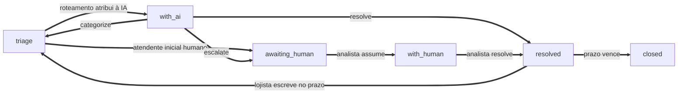

# Cloudesk · Banco, multi-marca e entidades

## O que é

O banco é o único sistema de estado do Cloudesk: atendimentos, mensagens, filas, regras, auditoria, jobs, tempo real e cache vivem no mesmo PostgreSQL 18. Esta parte define o modelo de dados e os invariantes que o próprio banco garante, sem depender da disciplina do código:

- **isolamento por marca**, com `brand_id` e Row-Level Security forçado em toda tabela de domínio;
- **papéis separados**, para que a aplicação nunca tenha privilégio de dono;
- **as entidades** do help desk e a **máquina de estados** da conversa;
- **a sequência das mensagens** por conversa, sem buracos nem repetição;
- **a auditoria append-only**, que nem o dono das tabelas altera;
- **a idempotência** das ações do agente;
- **as seeds** sintéticas e reproduzíveis.

## Onde fica no fluxo

```text
web, jobs-webhooks, jobs-default ── papel cloudesk_app ──┐
                                                         ├── PostgreSQL 18
migrações e seeds ───────────────── papel cloudesk_owner ┘     │
                                                               ├─ domínio: brand_id + RLS forçado
   Tenancy.with_brand(marca)                                   │   (marca da transação em app.brand_id)
     └─ BEGIN; set_config('app.brand_id', id, true); ...       ├─ brands, brand_channels: só leitura
                                                               └─ Solid Queue, Cable, Cache; gems
```

O Broker não acessa o banco: fala com o Core só por HTTP.

## Por que existe e que valor gera

**Isolamento entre marcas garantido pelo banco.** InfinitePay e JIM compartilham as mesmas tabelas, mas cada transação enxerga só as linhas da sua marca. Um erro no código, como uma consulta sem filtro, não vaza dados de uma marca para a outra: o banco simplesmente não devolve as linhas. Sem marca definida, nenhuma linha de domínio é visível nem gravável.

**A aplicação sem privilégio de dono.** O RLS não contém superusuários, papéis com `BYPASSRLS` nem, por padrão, o dono das tabelas. Por isso a aplicação conecta com um papel próprio, sem esses atributos, e as políticas são forçadas também para o dono. O isolamento vale qualquer que seja o papel conectado.

**Um único sistema de estado.** Jobs, tempo real e cache ficam no mesmo PostgreSQL (Solid Queue, Solid Cable e Solid Cache). A mudança de estado, a auditoria e o job de saída cabem na mesma transação, e não existe dual-write com um Redis ou uma fila externa.

**Ordem e integridade das mensagens.** A sequência de cada mensagem vem de um contador na conversa, incrementado na mesma transação: duas mensagens simultâneas na mesma conversa recebem números consecutivos e distintos. É essa sequência que a API de ações usa para recusar decisões tomadas sobre um contexto desatualizado.

**Auditoria que não se altera.** `audit_events` só aceita `INSERT`. `UPDATE`, `DELETE` e `TRUNCATE` são bloqueados por permissão e por trigger, inclusive para o dono das tabelas.

**Dados sintéticos reproduzíveis.** As seeds usam Faker com semente fixa, nos idiomas de cada marca. Nenhum dado real entra no sistema (LGPD), e rodar as seeds de novo não duplica registros.

## Como funciona

### Papéis

| Papel | Uso | Atributos |
| - | - | - |
| Superusuário da imagem | Script de inicialização: cria os papéis e os bancos | Superusuário |
| `cloudesk_owner` | Migrações e seeds | Dono das tabelas; sem superusuário, `BYPASSRLS` ou `CREATEDB` |
| `cloudesk_app` | `web`, `jobs-webhooks`, `jobs-default` e testes | Sem superusuário, `BYPASSRLS` ou `CREATEDB`; não é dono |

Permissões do papel da aplicação:

| Tabelas | Permissões |
| - | - |
| Domínio, exceto `audit_events` | `SELECT`, `INSERT`, `UPDATE`, `DELETE` |
| `audit_events` | `SELECT`, `INSERT` |
| `brands`, `brand_channels` | `SELECT` |
| Solid Queue, Solid Cable, Solid Cache, Active Storage, Action Mailbox | `SELECT`, `INSERT`, `UPDATE`, `DELETE` |
| `schema_migrations`, `ar_internal_metadata` | `SELECT` |
| Todas | Sem `TRUNCATE` |

Os nomes dos papéis são fixos, porque ficam gravados nos `GRANT` do `db/structure.sql`.

### Isolamento por marca

Toda tabela de domínio tem `brand_id` e a mesma política:

```sql
ALTER TABLE conversations ENABLE ROW LEVEL SECURITY;
ALTER TABLE conversations FORCE ROW LEVEL SECURITY;

CREATE POLICY brand_isolation ON conversations
  USING (brand_id = NULLIF(current_setting('app.brand_id', true), '')::uuid);
```

- Sem `WITH CHECK`, a mesma expressão vale para leitura e escrita: a aplicação não lê nem grava linha de outra marca.
- Sem o parâmetro, ou com ele vazio, a comparação com `NULL` não casa nenhuma linha: sem marca, nada é visível.
- `FORCE` submete o dono às políticas.

**Marca por transação.** `Tenancy.with_brand` é o único ponto do código que define a marca:

```sql
SELECT set_config('app.brand_id', '<id da marca>', true);
```

- Todo acesso ao domínio, inclusive leitura, acontece dentro desse bloco, que abre a transação (ou um savepoint, quando aninhado).
- O `true` limita o valor à transação. O pool reutiliza conexões entre requisições, e um valor de sessão passaria de uma requisição para a seguinte.
- O bloco aninhado restaura a marca anterior ao sair, com sucesso ou com erro.
- A leitura e a gravação de `app.brand_id` rodam sem o query cache, que devolveria um valor antigo de `current_setting` e deixaria de executar um `set_config` repetido.
- A chave do query cache é o SQL, sem a marca, e o mesmo SQL devolve linhas diferentes em cada marca. Quando o bloco muda a marca, o cache é limpo na entrada e na saída; o bloco aninhado da mesma marca mantém o cache.
- Nos jobs, a marca vem nos argumentos e é definida da mesma forma.

**Tabelas fora do RLS.** Ficam fora as tabelas sem `brand_id`: Solid Queue, Solid Cable e Solid Cache (os workers atendem todas as marcas), Active Storage e Action Mailbox (o e-mail chega antes de a marca ser conhecida), `brands` e `brand_channels` (lidas para descobrir a marca antes de defini-la). As duas últimas são só leitura para a aplicação.

**Cuidados com o que ignora o RLS.**

- **Índices únicos incluem `brand_id`.** As checagens de unicidade ignoram o RLS, e um índice único global revelaria a uma marca a existência de um valor em outra.
- **Chaves estrangeiras compostas com `brand_id`.** Cada tabela de domínio tem índice único em `(brand_id, id)`, e as referências são `(brand_id, <tabela>_id)` para `(brand_id, id)`. A checagem de integridade referencial também ignora o RLS; com a chave composta, o banco recusa a referência a uma linha de outra marca. Nenhuma chave estrangeira declara ação `ON DELETE`.
- **`TRUNCATE` não é concedido**, porque não é submetido ao RLS.

### Identificadores

Chaves primárias e `event_id` são UUID v7, gerados pelo banco com o default `uuidv7()` do PostgreSQL 18: ordenados no tempo, bons para índice e sem coordenação entre processos. O `event_id` é coluna de `audit_events`, com índice único em `(brand_id, event_id)`.

### Entidades

| Entidade | Tabela | Conteúdo |
| - | - | - |
| Brand | `brands` | Marca (InfinitePay, JIM), idioma e prazo de reabertura; fora do RLS |
| Team | `teams` | Equipe de analistas, com skills e horário comercial |
| Queue | `queues` | SLA, capacidade, atendente inicial (`ai` ou `human`), fila de transbordo e fila de escalação (fila humana da mesma marca) |
| RoutingRule | `routing_rules` | Condição (`when`) e resultado (`then`) em `jsonb`, posição, versão e `active`; cada versão é uma linha imutável |
| Contact | `contacts` e `contact_identities` | Lojista sintético e as identidades dele por canal (telefone, e-mail, id do app), únicas por marca |
| Conversation | `conversations` | Estado, fila, categoria, urgência, prioridade, SLA, entrada na fila humana, atendente e `last_sequence` |
| Message | `messages` | Canal, autor (lojista, IA, analista, sistema), texto, anexos e `sequence` |
| Attendant | `attendants` | Tipo (`ai` ou `human`), equipe, capacidade simultânea e skills |
| Handoff | `handoffs` | Motivo, resumo e contexto estruturado em `jsonb`; avaliação do briefing (`rating`: `useful` ou `not_useful`), analista que avaliou (`rated_by_id`) e horário (`rated_at`) |
| AuditEvent | `audit_events` | `event_id`, ator, ação, alvo, antes e depois, envelope, motivo, regra e versão, `trace_id` |
| CustomerMemory | `customer_memories` | Resumo das interações anteriores do lojista |
| Evento processado | `processed_events` | `idempotency_key` e o resultado da primeira execução da ação |

O model da entidade Queue é `Routing::Queue`, com a tabela `queues`: `Queue` é uma classe do Ruby no nível raiz (`Thread::Queue`), e um model com esse nome entraria em conflito com ela.

### Máquina de estados da conversa

O estado é um tipo enum do PostgreSQL, e as transições válidas ficam em um único lugar, `Conversation::TRANSITIONS`.

| Estado | Significado |
| - | - |
| `triage` | Entrou ou reabriu; aguarda classificação e roteamento |
| `with_ai` | Atribuída ao atendente IA |
| `awaiting_human` | Na fila humana, sem analista |
| `with_human` | Analista assumiu |
| `resolved` | Resolvida; dentro do prazo de reabertura |
| `closed` | Prazo de reabertura vencido; estado final |



| De | Para | Gatilho |
| - | - | - |
| `triage` | `with_ai` | Roteamento atribui à IA (F6) |
| `triage` | `awaiting_human` | Fila com atendente inicial humano (F6); disjuntor de IA (diferencial 3) |
| `with_ai` | `awaiting_human` | `escalate` (F8); varredura do timeout do agente (F11) |
| `with_ai` | `resolved` | `resolve` (F8) |
| `with_ai` | `triage` | `categorize` dispara novo roteamento (F8) |
| `awaiting_human` | `with_human` | Analista assume pela distribuição (F6) |
| `with_human` | `resolved` | Analista resolve (F11) |
| `resolved` | `triage` | Lojista escreve dentro do prazo de reabertura (F4) |
| `resolved` | `closed` | Prazo de reabertura vence (F4) |

A conversa abre sempre em `triage`. Depois de `closed`, uma nova mensagem do lojista abre outra conversa; um índice único parcial garante no máximo uma conversa não `closed` por lojista. Toda transição gera `audit_event`.

A separação entre `with_ai` e `awaiting_human` segue a referência do Chatwoot, indicada no TAPI, que distingue a conversa ainda com o bot (`pending`, "not yet ready for an agent to pick up") da conversa pronta para um agente (`open`). `awaiting_human` e `with_human` detalham o `open`.

### Sequência por conversa

```sql
UPDATE conversations
   SET last_sequence = last_sequence + 1
 WHERE id = $1
RETURNING last_sequence;
```

- O incremento acontece na mesma transação da mensagem. O `UPDATE` trava a linha da conversa até o commit e serializa as escritas concorrentes na mesma conversa.
- Se a mensagem não é gravada, o incremento é desfeito junto: a sequência não tem buracos.
- `messages` tem índice único em `(brand_id, conversation_id, sequence)`, como segunda barreira.
- Sequences do PostgreSQL não servem aqui: são globais, não por conversa, e deixam buracos quando uma transação é desfeita.

### `audit_events` append-only

1. **Permissão:** o papel da aplicação tem só `SELECT` e `INSERT`.
2. **Trigger:** `audit_events_block_row_changes` bloqueia `UPDATE` e `DELETE` linha a linha, e `audit_events_block_truncate` bloqueia `TRUNCATE`, para qualquer papel, inclusive o dono. São dois triggers porque o PostgreSQL só admite trigger de `TRUNCATE` por comando (`FOR EACH STATEMENT`).

As referências de `audit_events` a outras tabelas não usam `ON DELETE CASCADE`: a exclusão em cascata esbarraria no trigger.

### Eventos processados

`processed_events` é tabela de domínio, com `brand_id`, RLS e índice único em `(brand_id, idempotency_key)`. O registro de idempotência é gravado na mesma transação do efeito da ação do agente, e a linha guarda o resultado da primeira execução, que o Core devolve quando a mesma chave chega de novo. A inserção usa `ON CONFLICT DO NOTHING`: quando nenhuma linha é inserida, a ação já foi processada. A mesma chave pode existir em marcas diferentes.

### Schema versionado em SQL

O schema fica em `db/structure.sql`, porque o formato Ruby do Rails não expressa políticas, triggers, funções nem permissões; esses itens são criados com `execute` nas migrações.

- O Rails gera o arquivo com `pg_dump` sem privilégios. A task `core/lib/tasks/structure_privileges.rake` estende o `db:schema:dump` e acrescenta os `GRANT` e `REVOKE` do banco.
- Em banco vazio, o `db:migrate` carrega o `structure.sql` em vez de rodar as migrações. O banco de teste é montado assim, com o papel dono, e fica com as mesmas permissões de um banco migrado.

### Seeds

- **Determinismo:** `Faker::Config.random` com semente fixa; a versão do Faker fica travada no `Gemfile.lock`, porque os valores dependem dos dicionários da gem.
- **Idiomas:** `pt-BR` para a InfinitePay e `en-US` para a JIM.
- **Conteúdo, por marca:** os números de WhatsApp e e-mails de suporte, duas equipes, três filas, três regras, um atendente IA, quatro analistas e 50 lojistas com telefone, e-mail e id do app. A fila prioritária de cada marca escala para a fila humana financeira (`ip-financeiro-prioritaria` para `ip-financeiro`, `jim-finance-priority` para `jim-finance`); as filas gerais não têm fila de escalação.
- **E-mail em ASCII:** o username do Faker passa por `I18n.transliterate` (`barbara.costa@example.com`, e não `bárbara.costa@example.com`). Um e-mail com acento na parte local exigiria SMTPUTF8 em todo o caminho do e-mail. A transliteração não consome a semente.
- **Reexecução:** cada registro é buscado por uma chave natural e criado só se não existe. Com a semente fixa, a segunda execução gera os mesmos valores e encontra os registros.
- **Papel:** as seeds rodam com o papel dono, que grava em `brands`, e definem a marca por transação, pelo mesmo `Tenancy.with_brand` da aplicação.

## O que o sistema garante

- Uma marca não lê nem grava dados de outra, qualquer que seja o papel conectado.
- Sem marca definida, nenhuma linha de domínio é visível nem gravável.
- Nenhuma referência entre tabelas de domínio aponta para uma linha de outra marca.
- Nenhum índice único revela a uma marca valores de outra.
- Uma conversa só muda de estado pelas transições da tabela.
- As mensagens de uma conversa têm sequências consecutivas, sem buracos nem repetição, mesmo com gravações simultâneas.
- `audit_events` não aceita `UPDATE`, `DELETE` nem `TRUNCATE`.
- A mesma `Idempotency-Key` é registrada uma única vez por marca.
- As seeds rodadas de novo mantêm os mesmos registros.

## Como compõe os entregáveis do projeto

| Entregável | O que esta parte entrega | O que fica com outras partes |
| - | - | - |
| Plataforma multi-marca e multi-equipe | Isolamento por marca no banco, marcas, equipes e atendentes | Uso de `Tenancy.with_brand` em cada caminho |
| Múltiplas filas configuráveis | As tabelas de filas e de regras versionadas | Roteamento e gravação de regras (F6); admin (F13) |
| Rastreabilidade e auditoria | `audit_events` append-only, com ator, motivo, regra, versão e `trace_id` | Serviço de comando (F2) e linha do tempo (F14) |
| Handoff com resumo e contexto | A tabela de handoffs e o estado `awaiting_human` | Ação `escalate` (F8) e painel do analista (F11) |
| Memória e contexto entre interações | Uma conversa por lojista, identidades por canal e a tabela de memória | Identidade unificada (F4) e memória do lojista (F12) |
| Dados sintéticos (LGPD) | Seeds com Faker, sem nenhum dado real | Simulador de canais (F5) |

### No experimento técnico

| Hipótese | Contribuição |
| - | - |
| H3 · nada perdido nem duplicado | `processed_events` com índice único por marca é a barreira de deduplicação; a sequência por conversa é a base da recusa `stale` |
| H1 · 250 msg/s | O PostgreSQL concentra todo o estado e é o gargalo esperado; índices parciais e conexão direta com pool por processo fazem parte do dimensionamento |
| H2 e H4 | Não dependem do banco diretamente, mas cada transação de entrada entra na latência medida |

## Diferenciais

| Diferencial | Contribuição desta parte |
| - | - |
| 4 · "Por que caiu aqui?" | `audit_events` guarda a referência à versão exata da regra (`routing_rule_id` e `rule_version`), e as versões são imutáveis: a explicação continua válida depois que a regra muda |
| 3 · Disjuntor de IA | A transição `triage → awaiting_human` já está na máquina de estados para o disjuntor |

## Limitações

- **Isolamento lógico.** O isolamento entre marcas é por `brand_id` e RLS, não físico: as marcas dividem as mesmas tabelas, o mesmo banco e os mesmos recursos.
- **O PostgreSQL concentra todo o estado.** Domínio, jobs, tempo real e cache disputam o mesmo banco, que é o gargalo esperado de escala.
- **Sem particionamento.** `messages` e `audit_events` são tabelas únicas; o crescimento contínuo exige particionar.
- **Sem pooler de conexões.** A aplicação conecta direto ao Postgres, e o número de processos é limitado pelas conexões do banco.
- **Tabelas fora do RLS.** As tabelas das gems e `brands`, `brand_channels` não têm isolamento por marca no banco.
- **Enum de estado.** Valores de um enum do PostgreSQL não podem ser removidos; um estado novo é acrescentado, mas um estado existente não sai.
- **Seeds atreladas ao Faker.** Uma atualização do Faker muda os valores gerados; por isso a versão fica travada.

## Operação

### Verificação

Os testes conectam com o papel da aplicação, que é o papel contra o qual o isolamento precisa ser provado.

| Arquivo | O que comprova |
| - | - |
| `core/spec/tenancy/brand_isolation_spec.rb` | Papel sem privilégios; RLS habilitado e forçado em toda tabela de domínio, e só nelas; nada visível nem gravável sem marca; cada marca lê e grava só os próprios dados; chave estrangeira composta recusa outra marca; marca restaurada em blocos aninhados, com erro e com o query cache ligado |
| `core/spec/tenancy/owner_role_spec.rb` | O papel dono também obedece ao RLS |
| `core/spec/models/domain_schema_spec.rb` | `uuidv7()` nas chaves primárias, `brand_id` em todo índice único, permissões previstas, `brands` sem escrita, filas com transbordo e versões imutáveis de regras |
| `core/spec/models/conversation_spec.rb` | Abertura em `triage`, exatamente as transições da tabela e estado fora do enum recusado pelo banco |
| `core/spec/models/message_sequence_spec.rb` | Sequência a partir de 1, incremento desfeito sem a mensagem, índice único e duas mensagens concorrentes com sequências distintas e consecutivas |
| `core/spec/models/audit_event_spec.rb` | `event_id` UUID v7; `UPDATE`, `DELETE` e `TRUNCATE` recusados pela permissão e pelo trigger; nenhuma referência com `ON DELETE CASCADE` |
| `core/spec/models/processed_event_spec.rb` | Segunda inserção da mesma chave recusada na mesma marca e aceita em outra; resultado da primeira ação guardado |
| `core/spec/seeds_spec.rb` | Conteúdo das seeds em cada marca, e-mails em ASCII e mesma contagem na segunda execução |

## Relação com as outras partes

| Parte | Relação |
| - | - |
| Repositório e infraestrutura (F0) | Cria os papéis e os bancos e mantém os privilégios no `structure.sql` |
| Núcleo transacional e auditoria (F2) | Grava toda mudança com `audit_event` dentro de `Tenancy.with_brand` |
| Canais (F4) | Usa as identidades, a conversa única por lojista e o prazo de reabertura |
| Roteamento (F6) | Usa filas, regras versionadas, equipes, atendentes e as transições a partir de `triage` |
| API de ações (F8) | Usa `processed_events`, a sequência e as transições a partir de `with_ai` |
| Handoff e painel (F11) | Usa `handoffs` e as transições até `with_human` e `resolved` |
| Memória (F12) | Usa `customer_memories` |

## Fontes

- `documents/arquitetura.md`, seções "Domínio", "Decisões de design" e "Limites conhecidos"
- [PostgreSQL 18 · Row Security Policies](https://www.postgresql.org/docs/current/ddl-rowsecurity.html)
- [PostgreSQL 18 · Configuration Settings Functions](https://www.postgresql.org/docs/current/functions-admin.html)
- [PostgreSQL 18 · SET](https://www.postgresql.org/docs/current/sql-set.html)
- [PostgreSQL 18 · UUID Functions](https://www.postgresql.org/docs/current/functions-uuid.html)
- [PostgreSQL · CREATE TRIGGER](https://www.postgresql.org/docs/current/sql-createtrigger.html)
- [Rails Guides · Active Record Migrations](https://guides.rubyonrails.org/active_record_migrations.html)
- [Rails Guides · Active Record and PostgreSQL](https://guides.rubyonrails.org/active_record_postgresql.html)
- [Solid Queue · README](https://github.com/rails/solid_queue)
- [Faker · README](https://github.com/faker-ruby/faker)
- [Chatwoot · conversation.rb](https://raw.githubusercontent.com/chatwoot/chatwoot/develop/app/models/conversation.rb)
- [Chatwoot · Glossary](https://chatwoot.help/hc/user-guide/articles/1677141565-chatwoot-glossary)
- [AWS Database Blog · Multi-tenant data isolation with PostgreSQL Row Level Security](https://aws.amazon.com/blogs/database/multi-tenant-data-isolation-with-postgresql-row-level-security)
